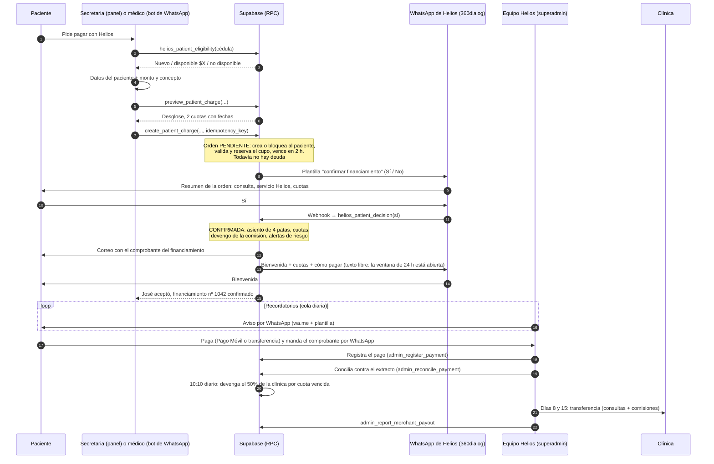
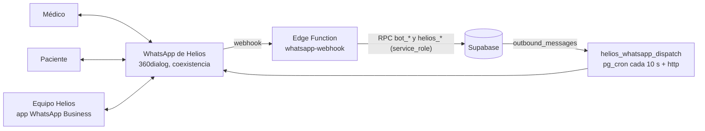

# Helios — Plan de implementación

> Pagos en cuotas para consultas y tratamientos de salud privada en Venezuela (medicina, odontología y cosmetología). Solo web, sin app móvil. Operado por **Quarto Latam, C.A.**
> 0% inicial · 2 cuotas (7 y 14 días) · comisión de servicio **12% + IVA** · límite inicial **$150** · a la clínica, **a los 8 y 15 días** · anclado al **dólar BCV**.
> Hermano de Ronda: mismo núcleo (libro contable, mora, liquidaciones, conciliación, paneles), sin nada de la app.

Fecha: 2026-09-30 (actualizado el 2026-10-05: WhatsApp por la API, el "Sí" del paciente y el bot del médico, §5.1 y §15; y el 2026-10-06: las reglas del negocio publicadas, §0.1) · Fuente: Ronda-panel @ `f3b5c6a` (2026-09-29) y Ronda-app/supabase @ `20260929140000` (354 migraciones).

---

## 0. Resumen ejecutivo

Helios es **Ronda sin la app**. Se reutiliza tal cual el 70-80% del backend y del panel. Estas son las cuatro cosas que cambian de verdad:

| # | Ronda | Helios |
|---|---|---|
| 1 | El cliente se registra en la app (OTP, PIN, KYC Didit) y "reclama" el cobro escaneando un QR | **La clínica registra al paciente y la consulta en un solo paso**, desde el panel o **desde WhatsApp** (el bot del médico, §15). No hay QR, ni KYC, ni login del paciente. El paciente **acepta respondiendo "Sí" a un WhatsApp de Helios** (§5.1); solo entonces existe la deuda y le llega **por correo el comprobante** con sus cuotas, fechas e instrucciones de pago |
| 2 | El cliente reporta sus pagos desde la app | **El paciente paga y manda el comprobante por WhatsApp al equipo Helios**, que lo **registra en el superadmin**. Desde ahí sigue la misma cola de conciliación de Ronda |
| 3 | Avisos por push (Expo) | **WhatsApp por la API (360dialog)** para la confirmación del paciente, la bienvenida y el bot del médico (§15). Los recordatorios de cuotas siguen en la **cola diaria operada por el equipo** (enlace `wa.me` de un clic) hasta que Meta apruebe sus plantillas |
| 4 | — | **Comisión a la secretaria** ($0,50, modificable) por cada financiamiento confirmado. Se devenga al confirmar y **se paga a la clínica el día siguiente**, con su pago diario |

Además cambian estas cosas:
- La moneda pasa del euro BCV al **dólar BCV**.
- El día operativo pasa de "10 AM a 10 AM" a **medianoche**.
- Solo está activo el nivel 1 (**$150** desde el 2026-10-06; antes $350).
- Todo el vocabulario de la interfaz cambia (local → clínica, consumo → **pago en cuotas** (antes "financiamiento"), usuario → paciente, cajero → secretaria).
- A la clínica se le paga a los 8 y 15 días, a diario, en lugar del cierre de los lunes (§0.1).

**Estrategia técnica:**
1. **No se reproducen las 354 migraciones.** Se consolida el estado final de Ronda en una **migración base**, se **podan** con un script los objetos exclusivos de la app y se valida con `plpgsql_check`.
2. Encima de esa base van **migraciones pequeñas y propias de Helios**.
3. El panel se copia de Ronda-panel y se poda con el mismo criterio.
4. Todo vive en **un solo repositorio**, porque ya no hay app que obligue a separarlo.

### 0.1 Las reglas del negocio publicadas (2026-10-06)

Javier fijó la información pública del negocio el 2026-10-06. Manda sobre cualquier cifra anterior de este documento:

| Tema | Regla | Antes | Dónde vive |
|---|---|---|---|
| Qué es | Una forma de pagar **consultas y tratamientos de salud privada en cuotas** | "BNPL para consultas médicas" | Portada, condiciones |
| Especialidades | **Medicina, odontología y cosmetología** | Medicina y odontología | `merchant_category` + `cosmetologia` (20261006001100) |
| Cómo funciona | El médico registra la consulta → el paciente confirma ("Sí" por WhatsApp) → paga en dos cuotas | — | §2 |
| Comisión de servicio | **12% + IVA 16%** sobre la comisión, la paga el paciente. Consulta de $100 → $12 + $1,92 = $113,92 → 2 × $56,96 | 20% + IVA ($123,20 → 2 × $61,60) | `consumer_fee_pct` = 12 desde el 2026-10-06 (20261006001000) |
| Límite | **Límite inicial de $150.** No se dice que "crece": los niveles 2-5 siguen apagados y no hay regla para subir | $350 | `levels` nivel 1 (20261006001000) |
| Pago a la clínica | **En dos partes, a los 8 y a los 15 días**: cada mitad el día siguiente al vencimiento de su cuota. **Garantizado aunque el paciente no pague.** Se paga a diario | 50% al vencer cada cuota, todo junto el lunes siguiente (8 a 20 días) | `helios_settlement_run_for(d) = d + 1`, `helios_next_settlement_run = hoy` (20261006001200) |
| Comisión de la secretaria | Se paga **el día siguiente** a la confirmación | El lunes siguiente | La misma regla de arriba |
| Costo para el médico | **Ninguno**: la comisión la paga el paciente | — | — |
| Permanencia | **No hay**: el médico o centro cancela con aviso previo | — | Condiciones, contrato |
| Afiliación | Botón **"Quiero afiliarme"** → WhatsApp de Helios con el mensaje escrito | — | `panel/src/config/legal.ts` (`whatsapp`) |
| Operador | **Quarto Latam, C.A.**, con términos y condiciones públicos | Razón social por definir | `config/legal.ts`, `/legal/terminos` |
| Vocabulario | **"Pago en cuotas"** y **"comisión de servicio"**. Nunca "préstamo" ni "financiamiento" en nada externo (portada, panel de la clínica, bot, WhatsApp, correos) | "Financiamiento", "cargo por servicio", "fee" | `CLAUDE.md` › Nombres |
| No se publica | La tasa del euro BCV, que no se verifica al paciente, los firmantes del contrato, los detalles internos del admin | — | — |

El resto del documento conserva "financiamiento" como término interno del diseño (y la base, sus nombres: `charges`, `comprobante_financiamiento`…); hacia fuera se dice "pago en cuotas".

**Qué cambió en el sistema por estas reglas:**
- Las cuotas de una consulta de $100 bajan de $61,60 a $56,96. Los pagos en cuotas ya confirmados conservan su desglose.
- La plantilla de Meta aprobada (`helios_confirmar_financiamiento`, §15.5) dice "20 %" y "financiamiento": deja de usarse hasta que Meta apruebe la v3 (§15.5.2). Mientras tanto, fuera de la ventana de 24 h la pregunta al paciente cae a la cola manual de "Avisos de hoy". **La v3 está aprobada y conectada desde el 2026-10-08.**
- El cierre semanal desaparece: el equipo de Helios transfiere a las clínicas **cada día** lo que vence (más trabajo operativo; ver §6 y §8.3).

---

## 1. Decisiones tomadas

| Tema | Decisión | Origen |
|---|---|---|
| Moneda | ~~Solo dólar BCV~~ (2026-09-30). **El médico cobra en dólares o en euros**, a su elección en el paso del monto (panel y bot). En el bot, **la moneda elegida manda sobre el símbolo escrito**: con euros elegidos, «$80» son €80 (Javier, 2026-10-13); el símbolo solo cuenta si aún no hay moneda, y solo la cambian el botón o una línea «Moneda:». Una orden en euros queda en euros: el paciente paga cada cuota en Bs a la tasa BCV del euro del día en que paga y a la clínica se le paga en Bs a la tasa del euro. El libro, los límites, la mora y el superadmin siguen en **dólares** (la orden en euros se convierte con la tasa cruzada del día del registro) | Javier, 2026-10-07 |
| Medios de pago del paciente | **Solo bolívares**: Pago Móvil o transferencia. Fuera Zelle, USDT y efectivo | Javier, 2026-10-07 |
| Cargos por mora | **Apagados por ahora** (`late_fee_usd` = 0). El motor se queda en el código; retomarlo es volver a poner el monto en el parámetro | Javier, 2026-10-07 |
| Montos al paciente | **La moneda y los bolívares**: «€56,96 (Bs 56.063,47)»; el monto en la moneda es fijo y los Bs son los de la tasa del día. Desde el 2026-10-19 los Bs van solo en el bloque de pago, junto a las cuentas (§15.8) | Javier, 2026-10-07 |
| Aceptación del paciente | ~~Solo la registra la secretaria~~ (2026-09-30). **Sustituida:** el paciente acepta respondiendo **"Sí"** a un WhatsApp de Helios con el resumen de la orden. Sin "Sí" no hay deuda (§5.1) | Javier, 2026-10-05 |
| Plazo para aceptar | La orden espera el "Sí" **2 horas**. Si vence, la clínica la **reenvía** (nuevo plazo de 2 h, mismas fechas recalculadas) | Javier, 2026-10-05 |
| Cupo durante la espera | La orden pendiente **reserva el cupo** del paciente hasta que acepte, rechace o venza | Javier, 2026-10-05 |
| Panel y WhatsApp | El panel web **también exige el "Sí"**: un solo modelo para los dos canales | Javier, 2026-10-05 |
| Canal del médico | Los médicos registran y consultan **desde WhatsApp** (muchos no tienen secretaria ni computador) | Javier, 2026-10-02 |
| Identidad del médico | El equipo de Helios **registra su número**; escribir desde ese número lo identifica. **Sin PIN** desde el 2026-10-13 (Javier; antes lo pedía para cada orden). Nunca usuario y clave por chat | Javier, 2026-10-02 y 2026-10-13 |
| Alta de paciente nuevo por WhatsApp | El médico manda **todos los datos en un solo mensaje**; el bot los lee con el formulario o con solo las respuestas en orden (sin IA desde el 2026-10-09), pide lo que falte y muestra un resumen antes de confirmar | Javier, 2026-10-02 |
| Proveedor de WhatsApp | **360dialog**, **un solo número con coexistencia**: la app WhatsApp Business para el equipo y la API para el bot y los envíos automáticos | Javier, 2026-10-05 |
| Total al paciente | **Al paciente sí se le enseña el total con el cargo por servicio**; a la clínica, nunca. Montos de los mensajes al estilo venezolano ($1,92) | Javier, 2026-10-06 |
| Bot del paciente | Menú con **Pagar mi cuota**, **Mi saldo y cuotas** (lo disponible, las cuotas y el historial) y **Hablar con alguien** antes de que atienda una persona (§15.6, §15.8). ~~Pagar cuota, Mis pagos en cuotas y Ayuda~~ (2026-10-06) | Javier, 2026-10-19 |
| Mensajes al paciente | **Nombran al médico** («la Dra. …»), no a la clínica; los **bolívares solo junto a las cuentas**, como el equivalente de hoy; cada bloque de pago recuerda **«pagar a tiempo para subir de nivel»** (§15.8) | Javier, 2026-10-19 |
| IA del bot | **Ninguna** (antes Gemini, y antes Claude): el formulario va en un mensaje aparte para copiarlo, y valen también las respuestas sin etiquetas en el orden de las preguntas | Javier, 2026-10-09 |
| Pago y reporte del paciente | **Por WhatsApp al equipo Helios**, que registra el pago en el superadmin | Javier, 2026-09-30 |
| Comisión de la secretaria | **Se suma a la liquidación de la clínica**, y la clínica se la entrega a su personal | Javier, 2026-09-30 |
| Antifraude | **Solo alertas automáticas.** Los topes por clínica, la retención de liquidaciones y el expediente con fotos se evaluarán después (§14) | Javier, 2026-09-30 |
| Privacidad entre clínicas | Una clínica que busca una cédula ve ~~el nombre enmascarado~~ el nombre, el teléfono y el correo completos (2026-10-21) y "disponible $X" o "no disponible", nunca la deuda ni el motivo | Javier, 2026-09-30 / 2026-10-21 |
| Avisos | **5 momentos** por vencimiento (§7.2), no los 12 de Ronda | Javier, 2026-09-30 |
| Comisión de servicio | ~~20% + IVA~~ (2026-09-30). **12% + IVA** al paciente, 0% a la clínica | Javier, 2026-10-06 |
| Liquidación a la clínica | ~~Igual que Ronda: 50% al vencer cada cuota, pagado los lunes~~ (2026-09-30). **50% a los 8 días y 50% a los 15** (el día siguiente a cada vencimiento), a diario, cobre Helios o no | Javier, 2026-10-06 |
| Especialidades | Medicina, odontología y **cosmetología** | Javier, 2026-10-06 |
| Permanencia | Ninguna: el médico o centro cancela con aviso previo | Javier, 2026-10-06 |
| Operador | **Quarto Latam, C.A.** | Javier, 2026-10-06 |
| Vocabulario externo | "Pago en cuotas" y "comisión de servicio"; nunca "préstamo" ni "financiamiento" | Javier, 2026-10-06 |
| Cuentas de cobro de Helios | **Configurables** desde Ajustes, como en Ronda; se llenan después | Javier, 2026-09-30 |
| WhatsApp de Helios | **Configurable** desde Ajustes | Javier, 2026-09-30 |
| Cuotas | 0% inicial, 2 cuotas a +7 y +14 días desde la fecha del financiamiento | Brief |
| Niveles | Motor de niveles igual que Ronda. Solo el **nivel 1** activo: ~~$350~~ **$150 desde el 2026-10-06** ("límite inicial"); los niveles 2-5 existen con `is_active = false` | Brief; Javier, 2026-10-06 |
| Stack | El mismo de Ronda, sin la app: TanStack Start + Supabase + Vercel + Sentry | Brief |

### 1.1 Reglas heredadas de Ronda tal cual (por defecto, salvo que se diga lo contrario)

| Regla | Valor en Helios | Parámetro |
|---|---|---|
| Comisión de servicio al paciente | **12%** sobre el monto de la consulta, **+ IVA 16%** sobre la comisión (20% hasta el 2026-10-05) | `consumer_fee_pct`, `vat_pct` |
| El fee no ocupa cupo | Se financia la consulta, no la comisión de Helios | — |
| Ejemplo con una consulta de $100 | Paciente debe **$113,92** = 2 × $56,96. Clínica recibe **$100**. Ingreso Helios $12. IVA $1,92 | — |
| Liberación de cupo | Por financiamiento: se libera al pagar **ambas** cuotas. Cualquier cuota vencida deja el disponible en $0 | — |
| Mora | Día 1: congelado. **Cargo de $2 por cuota tras 3 días de gracia.** Día 30: suspendido (y baja de nivel, que en nivel 1 no cambia nada). Día 60: expulsado, lista negra de la cédula y castigo contable | `late_fee_usd`, `late_fee_grace_days`, `mora_demotion_days`, `mora_expulsion_days` |
| Liquidación a la clínica | **100% del precio en dos mitades**: el 50% se devenga al vencer cada cuota (días 7 y 14) y se paga **el día siguiente** (días 8 y 15), cobre Helios o no. Hasta el 2026-10-05, en el cierre de los lunes | `merchant_terms` (0/50/0, `scheduled`), `helios_settlement_run_for` |
| Monto mínimo | $10 propuesto (en Ronda eran €5; ver D-H7) | nuevo `min_charge_usd` |
| Tasa | BCV del día; fines de semana y feriados usan la última publicada; ingesta a las 10:00 con reintentos | `sync_fx_rate()` |
| Frenos de emergencia | Mantenimiento global y bloqueo manual por paciente | — |
| Bitácora | Toda acción de admin queda en `audit.admin_actions` (append-only) | — |
| Seguridad del equipo | MFA TOTP obligatorio para admins | `platform_security.require_mfa` |

---

## 2. Flujo de uso



### 2.1 Paso a paso en la clínica ("Nuevo financiamiento")

1. **Cédula** (V/E + número). La RPC `helios_patient_eligibility` responde una de tres cosas, **sin revelar la deuda ni el motivo**:
   - **Paciente nuevo**: pide todos los datos.
   - **Paciente conocido**: muestra su nombre, su teléfono y su correo **completos** (desde el 2026-10-21; antes, enmascarados) para confirmarlos, y el **disponible para financiar: $X**.
   - **No disponible**: "No podemos financiar a esta persona. Si tiene dudas, que escriba a Helios al …". Cubre mora, lista negra, bloqueo, mantenimiento y cupo agotado.
2. **Datos del paciente**, todos obligatorios salvo que se indique:
   - Identidad: nombres, apellidos, fecha de nacimiento (calcula la edad y **exige ≥ 18**: si quien se atiende es menor, se registra a su **representante** como titular de la deuda; D-H5) y sexo.
   - Contacto: teléfono móvil con WhatsApp (valida los prefijos 0412/0414/0416/0422/0424/0426) y **email (obligatorio: ahí llega el comprobante)**, escrito dos veces para evitar errores de tipeo.
   - Dirección: estado, ciudad y dirección corta.
   - ~~Contacto de referencia para cobranza~~: **ya no se pide** (Javier, 2026-10-13; 20261013000100). Los pacientes que lo dieron lo conservan.
   - Opcional: ocupación.
3. **Monto y concepto**: **monto libre** en dólares (≥ `min_charge_usd`, máx. 2 decimales, y dentro del disponible) y un concepto corto opcional ("Consulta", "Consulta + eco"). **No hay catálogo** (D-H4). Opcional: "paciente atendido", si es distinto del titular (el menor que se atendió).
4. **Vista previa** (`preview_patient_charge`): monto de la consulta, 2 cuotas con fechas y el monto de cada una. El fee aparece **solo dentro de las cuotas o como línea aparte**, nunca sumado en un total (regla de Ronda).
5. **Enviar al paciente**: `create_patient_charge` crea la **orden pendiente** y Helios le manda al paciente un WhatsApp con el resumen y dos botones, **Sí, acepto** / **No** (§5.1). La pantalla pasa a **"Esperando al paciente"**, con la cuenta atrás de 2 horas y el teléfono enmascarado al que se envió ("0414-\*\*\*-\*\*67"). Todavía no hay deuda.
6. **El paciente responde**:
   - **Sí** → el financiamiento queda **confirmado** y la pantalla lo muestra al instante. A partir de aquí la deuda existe.
   - **No** → la orden queda **rechazada** y se libera el cupo. Si fue un error, se registra otra.
   - **Sin respuesta en 2 h** → la orden **vence** y se libera el cupo. Botón **"Reenviar al paciente"**: revalida cupo y elegibilidad, recalcula las fechas y abre otras 2 h.
7. **Comprobante por correo**: al confirmarse se envía solo, en segundos (§7.3), junto con la bienvenida por WhatsApp. La pantalla dice "Comprobante enviado a j\*\*\*@gmail.com" y tiene un botón **"Reenviar comprobante"**. Si el correo rebota, Helios recibe una alerta y la clínica ve el aviso "El correo del paciente no es válido" en el detalle del financiamiento.

**Interruptor de puesta en marcha:** el parámetro `patient_confirmation_required` arranca en **0**: mientras Meta no apruebe la plantilla, `create_patient_charge` confirma al instante como hasta ahora y la bienvenida va a la cola manual. Con **1** se activa el flujo de arriba, para el panel y para el bot a la vez.

### 2.2 Paso a paso por WhatsApp (el bot del médico)

El mismo flujo, conversado. El detalle técnico está en §15.

1. El médico escribe al WhatsApp de Helios desde **su número registrado**. El bot le ofrece botones (sin PIN desde el 2026-10-13): **Nuevo financiamiento**, **Mis financiamientos**, **Ayuda**.
2. **Cédula** → la misma respuesta que en el panel (nuevo / disponible $X con su nombre y su teléfono / no disponible, sin motivo).
3. **Paciente conocido**: pide monto y concepto ("$80, Limpieza Dental"). **Paciente nuevo**: pide **todos los datos en un solo mensaje** (el bot le manda el formulario en un mensaje aparte para copiarlo; valen también solo las respuestas, una por línea y en orden). El bot **pregunta solo lo que falte** y nunca inventa un dato.
4. **Resumen**: datos del paciente (con el **correo bien visible**, porque ahí llega el comprobante), monto de la consulta, línea "Servicio Helios 20 % + IVA" y las 2 cuotas con fechas. Botones **Confirmar** / **Corregir**.
5. **Confirmar** → orden pendiente → WhatsApp al paciente. El bot avisa "Esperando la respuesta de José (vence a las 16:40)".
6. El bot le avisa al médico cuando el paciente **acepta**, **rechaza** o la orden **vence** (con botón **Reenviar**).

---

## 3. Arquitectura

### 3.1 Stack (el de Ronda sin la app)

| Capa | Elección |
|---|---|
| Web (clínica + superadmin) | **TanStack Start** (Vite 8, TanStack Router y Query, React 19, Tailwind v4), el mismo kit de UI propio de Ronda |
| Backend | **Supabase Postgres 17**: RLS + RPC `security definer`, `pg_cron`, `http`, Storage y Auth (email + contraseña y MFA TOTP) |
| API | **Ninguna para el panel.** Igual que el panel de Ronda: cliente de Supabase con clave publicable, RLS y RPC. No hay Hono ni server functions |
| WhatsApp | **360dialog** (Cloud API de Meta), un solo número con coexistencia. Salida: cola `outbound_messages` + `pg_cron` + `http` (como el correo). Entrada: **una Edge Function, `whatsapp-webhook`** (la única pieza con runtime propio, §15) |
| IA del bot | **Ninguna** desde el 2026-10-09 (Javier: Gemini era poco útil). Los datos se leen con código (`datos.ts`) y la intención con botones y palabras clave |
| Deploy | Vercel (panel, preset Nitro) y Supabase (dos proyectos: `Helios` y `Helios-dev`) |
| Observabilidad | Sentry (panel) |
| Asistente IA (fase 5, 2026-10-23) | Edge Function `admin-asistente` portada de Ronda: solo lectura, con Claude (`claude-sonnet-5-5` y esfuerzo `low`, Javier 2026-10-23; `ASISTENTE_MODELO` lo cambia) y la misma `ANTHROPIC_API_KEY` del lector de comprobantes. Lee las RPC `admin_*` y las vistas `asistente.*` de Helios (`20261023010000`); se enseña con `VITE_ASISTENTE=1` |

### 3.2 Repositorio: uno solo

Ronda tiene tres repositorios (workspace, app y panel), y sus migraciones viven en el de la app; su propio README pide sacarlas. Helios no tiene app, así que conviene **un repositorio con todo**:

```
Helios/                          ← repo git (GitHub: Helios)
├── docs/                        ← este plan, reglas de negocio, decisiones
├── tokens/                      ← helios.tokens.json + build.mjs (solo genera el panel)
├── brand/                       ← logo e isotipo (SVG)
├── panel/                       ← TanStack Start (fork de Ronda-panel)
│   ├── src/ …
│   ├── scripts/
│   ├── .env.example  .env.dev  .env.prod
│   └── vercel.json
├── supabase/
│   ├── config.toml
│   ├── migrations/              ← 1 base consolidada + migraciones de Helios
│   ├── poda/                    ← scripts reproducibles que generaron la base (trazabilidad)
│   ├── tests/                   ← suites SQL (patrón de Ronda) + run.sh
│   ├── seed.sql                 ← clínica demo, personal, admin local
│   ├── bootstrap_superadmin.sql
│   └── functions/               ← whatsapp-webhook (§15); (fase 5) admin-asistente
├── scripts/
│   └── portar-de-ronda.mjs      ← transforma una migración de Ronda al vocabulario de Helios
├── .github/workflows/ci.yml     ← panel (tipos, lint, tests) + BD (supabase start + tests SQL)
└── .claude/launch.json
```

### 3.3 Nombres en la base: mantener los de Ronda

**Decisión recomendada:** la base conserva los nombres de dominio de Ronda (`profiles`, `merchants`, `charges`, `installments`, `settlements`, `*_usd`…). Solo se renombra el prefijo de marca `ronda_` a `helios_`. La interfaz habla en vocabulario médico.

- **Por qué:** así un arreglo hecho en Ronda (mora, conciliación, métricas) se porta a Helios con un script mecánico (`scripts/portar-de-ronda.mjs`: `ronda_` → `helios_`, textos "Ronda" → "Helios"), en lugar de reescribirse. Es lo que pediste: facilitar el mantenimiento.
- **Bonus:** los sufijos `_usd`, que en Ronda son un nombre histórico (hoy guardan euros), en Helios vuelven a ser literalmente ciertos.

| En la base | En la interfaz de Helios |
|---|---|
| `merchants` / `merchant_branches` | Clínica o consultorio / Sede |
| `merchant_users` (`gerente`, `cajero`) | Personal: **Administrador** / **Secretaria (recepción)** |
| `profiles` | Paciente |
| `charges` / `charge_items` | Pago en cuotas (antes "financiamiento") / Servicios |
| `installments` | Cuotas |
| `settlements` / `merchant_payouts` | Devengos / Pagos a la clínica |
| `payment_reports` | Pagos registrados |

---

## 4. Base de datos

### 4.1 Cómo se construye la migración base (fase 0)

Replicar 354 migraciones llenas de `create or replace` sucesivos (`confirm_charge` tiene 16 versiones) y luego borrar la mitad es frágil. En su lugar:

1. **Estado final reproducible de Ronda.** En local, `supabase start` + `supabase db reset` sobre `Ronda-app/supabase`. Se reproducen las 354 migraciones y el resultado es exactamente lo que dice git, sin la deriva que pueda haber en dev.
2. **Volcado de esquema.** `supabase db dump --local --schema public,ledger,audit,metricas,asistente` → `poda/00_ronda_final.sql`. Hay que añadir a mano, porque no salen en ese volcado:
   - los **jobs de `pg_cron`** (se leen de `cron.job` y se reescriben como `cron.schedule(...)`);
   - las **políticas de Storage** (`storage.objects`) y los buckets;
   - el rol `asistente_lector`, solo si se porta el asistente.
3. **Datos de configuración** (volcado de datos): `levels`, `business_parameters`, `business_parameter_catalog`, `notification_templates`, `collection_templates`, `fx_rate_sources`, `holidays`. **Nunca** datos de personas.
4. **Poda (`poda/01_…sql`).** Se hace `DROP` explícito de todo lo clase B (§4.2), **sin `CASCADE`**. Con `RESTRICT`, cualquier vista o función reutilizable que dependa de algo podado **hace fallar la poda** en vez de desaparecer en silencio. Cada fallo es una dependencia que hay que arreglar a conciencia.
5. **Renombrado de marca.** Se aplica `scripts/portar-de-ronda.mjs` al volcado podado.
6. **Validación estática.** Se activa la extensión **`plpgsql_check`** (disponible en Supabase) y se corre sobre todas las funciones. Postgres no valida los cuerpos de PL/pgSQL al crearlos, así que una función que lea `bits_entries` o `group_members` después de la poda **solo fallaría en producción**. Hay que llegar a **cero errores**.
7. **Reglas de mora y dinero.** Se portan y adaptan las suites SQL de Ronda (§9) y deben pasar en verde.
8. El resultado es `supabase/migrations/20261001000000_helios_base.sql`. Los scripts de `poda/` se versionan para poder regenerar la base si hace falta.

### 4.2 Qué se poda (clase B: exclusivo de la app o de la vida nocturna)

| Área | Tablas / objetos | Funciones (patrones) |
|---|---|---|
| PIN y dispositivos | `user_pins`, `pin_attempts`, `user_devices` | `set_user_pin`, `verify_user_pin`, `has_user_pin`, `pin_pepper`, `register_device`, `check_device_login`, `record_failed_pin_login`, `clear_pin_lockout` |
| KYC Didit | esquema `kyc` completo, buckets `kyc-documents` y `kyc-archive` | `start_kyc_verification`, `confirm_kyc_data`, `kyc_*`, `notify_kyc_rejected`, `admin_kyc_*`, `admin_review_kyc`, `admin_user_verification`, `admin_request_new_verification`; Edge Functions `kyc-*` |
| Push | `push_tokens`, `push_deliveries`, `promo_campaigns` | `register_push_token`, `dispatch_push_queue*`, `check_push_receipts*`, `enqueue_push`, `purge_push_queue`, `promo_audience`, `admin_send_promo`, `admin_promo_*` |
| Grupos / mesas | `groups`, `group_members` | `*group*`, `ronda_group_*`, `ronda_split_shares`, `ronda_payables`, `installment_not_in_a_live_group`, `installment_unlocks_at`, `my_locked_installments`, `realtime_*` |
| QR / reclamo | — | `preview_charge`, `confirm_charge` (su lógica pasa a `create_patient_charge`), `confirm_charge_as_group`, `expire_stale_charges` y su cron |
| Bits | `bits_entries` | `ronda_bits_*`, `award_bits_*`, `my_bits`, `notify_bits_earned`, trigger `installments_award_bits` |
| App | `app_release`, `app_activity`, `avatar_emojis`, `avatar_colors`, `user_payment_methods`, `account_deletion_requests` | `ronda_app_gate`, `ronda_app_releases`, `admin_set_app_release`, `log_app_activity`, `set_my_avatar`, `my_*` (la vista del usuario), `accept_terms`, `ack_level_up`, `my_pending_level_up`, `*deletion*` |
| Piloto La Quinta | `merchant_vaults`, `merchant_vault_topups`, `credit_waitlist`, `qa_case_marks` | `admin_vault_*`, `admin_waitlist*`, `ronda_waitlisted`, `ronda_settle_vaults`, `enroll_in_waitlist_on_activation`. **Ojo:** `ronda_spend_block` y el bucle de liquidaciones llaman a la bóveda y hay que limpiarlos |
| Métricas de noche o grupos | vistas de `metricas` que lean grupos, KYC o push | `admin_group_metrics`, `admin_nights`, `admin_growth_funnel` (el embudo KYC), `admin_metricas_avisos*` |
| Enums | valores `pending_kyc`, `pending_pin`, `group_charge`, `tab_*`, `bits_earned`… | Se quedan (quitar valores de un enum no compensa) pero no se usan |

### 4.3 Qué se reutiliza tal cual (clase A)

- **Libro contable** `ledger.*`:
  - partida doble, append-only;
  - balance verificado por un trigger diferido;
  - idempotencia por `idempotency_key`.
- **Deuda**:
  - `ronda_assign_debt` (el único sitio que crea deuda), `ronda_charge_breakdown`, `user_credit_blocks`;
  - `ronda_credit_used_usd`, `can_take_debt`, `ronda_in_arrears`, `available_usd`.
- **Cobro y mora**:
  - `ronda_quote_installments(p_user, …)`, `reconcile_payment`, `charge_late_fee`;
  - `recompute_profile_mora_state`, `charge_off_user_debt`, `process_mora_loop`.
- **Liquidaciones**:
  - `merchant_terms`, `settlements`, `merchant_payouts` y sus ítems;
  - `run_scheduled_settlements_loop`, `ronda_settlement_run_for`, `ronda_next_settlement_run`, `ronda_settlement_outlook`, `admin_report_merchant_payout` (acepta pagos parciales).
- **Banco**:
  - `bank_statement_lines`, `statement_imports`, `ronda_statement_candidates`;
  - `admin_import_statement`, `admin_unmatched_deposits`, `admin_assign_deposit`, `admin_link_*`, `bank_balance_checks`, `admin_cash_forecast`.
- **Tasa**: `exchange_rates`, `fx_rate_sources`, `fx_rate_syncs`, `sync_fx_rate` (con sus guardas), `admin_set_fx_rate`, `current_fx_rate`.
- **Configuración**: `business_parameters` (con vigencia), `holidays`, `levels`, `level_changes`, `evaluate_level`.
- **Cobranza y riesgo**: `collection_contacts`, `collection_templates` (por tramos), `admin_collections*`, promesas, `risk_alert_reviews`, `admin_risk_alerts`, cohortes, `cash_forecast_snapshots`.
- **Plataforma**: `platform_admins`, `platform_security`, `is_platform_admin()`, `ronda_assert_super_admin()`, `platform_maintenance`, `user_blocks`, `audit.log`.
- **Personal de la clínica**: `merchant_users`, `merchant_staff_*`, `can_manage_merchant_staff`, `admin_create_auth_account`.

### 4.4 Migraciones propias de Helios (después de la base)

Cada una es pequeña, lleva su suite de pruebas y usa nombres en español al estilo de Ronda.

**H1 — `el_precio_se_pacta_en_dolares`**
- `exchange_rates.source = 'BCV'` pasa a ser **USD**. Se reactivan las fuentes `dolarapi` (`/v1/dolares/oficial`) y `er-api` (`/latest/USD`) y se desactivan las de EUR.
- Se revisan los rangos de `fx_rate_rejection()` para el dólar.
- `levels`:

  | Nivel | Límite | Activo | Etiqueta |
  |---|---|---|---|
  | 0 | 0 | no | "Sin nivel" |
  | **1** | **150** (350 hasta el 2026-10-05) | **sí** | — |
  | 2 | 500 | **no** | — |
  | 3 | 700 | **no** | — |
  | 4 | 1.000 | **no** | — |
  | 5 | — | no | "Próximamente" |

  Los niveles 2-4 son de ejemplo y quedan apagados; se deciden cuando se abran.
- `business_parameters`: `late_fee_usd = 2`, `min_charge_usd = 10` (nuevo, D-H7; sustituye el `check (amount_usd >= 5)` rígido).

**H2 — `el_dia_operativo_empieza_a_medianoche`**
- `helios_business_date(ts)` = `(ts at time zone 'America/Caracas')::date`, sin el desfase de −10 h pensado para la noche.
- Se añade el parámetro `business_day_offset_hours = 0` por si hiciera falta.
- Se revisan todas las funciones que llaman al día operativo o a la "noche" (métricas por hora rotadas a las 10 AM).
- La hora de los crons (tasa 10:00 → mora 10:05 → liquidaciones 10:10 → niveles 10:20) **se mantiene**: el BCV publica por la mañana.

**H3 — `el_paciente_no_tiene_cuenta`** (la adaptación más delicada)
- `profiles.id` pierde la FK a `auth.users` y pasa a `default gen_random_uuid()`. Se elimina el trigger `on_auth_user_created → handle_new_user`: ningún `auth.users` vuelve a crear un perfil.
- Las FK a `auth.users` en `charges.user_id`, `installments.user_id`, `user_credit_blocks`, `late_fees`, `payment_quotes`, `payment_reports`, `level_changes`, `notifications` y `user_blocks` se **reapuntan a `profiles(id)`**.
- `phone_e164` sigue siendo obligatorio pero **deja de ser único**: en una familia se comparte el teléfono. Un teléfono repetido dispara una **alerta de riesgo**.
- **La identidad única pasa a ser la cédula** (`document_key`, que ya es único).
- Columnas nuevas:
  - `email`, `sex`, `state`, `city`, `address`, `occupation`;
  - `reference_name`, `reference_phone`, `reference_relationship`;
  - `registered_by` (staff), `registered_merchant_id`.
- Un paciente nuevo nace `active` con `level = 1` **en el INSERT**. Ojo: `grant_first_level_on_activation` solo se dispara en UPDATE.
- Las RPC que usaban `auth.uid()` como deudor (`quote_installments`, `report_payment`, `my_*`) se podan o se sustituyen por sus variantes con `p_user` para uso del admin.

**H4 — `registrar_un_financiamiento`**: `helios_patient_eligibility`, `preview_patient_charge` y `create_patient_charge` (§5).

**H5 — `la_comision_de_la_secretaria`** (§6).

**H6 — `el_comprobante_llega_por_correo`** (§7.3)
- Canal `email` en **`outbound_messages`** (la tabla de H7), con despacho automático desde la base: `pg_cron` cada minuto + `http` hacia la API de **Resend**. Es el mismo patrón que la tasa BCV y que la cola de push de Ronda: sin runtime aparte y la cola se puede consultar y auditar.
- Columnas propias del correo: `email`, `subject`, `html`, `provider_id`, `attempts`, `next_attempt_at` (reintentos con espera creciente), `last_event` (`sent`/`delivered`/`bounced`/`complained`).
- Un cron cada 15 min consulta el estado de los enviados (el equivalente de `check_push_receipts`). Si **rebota**, marca `profiles.email_invalid_at` y crea la alerta `correo_rebotado`.
- Plantilla `comprobante_financiamiento` (HTML), versionada en `terms_versions` (H9). Cada financiamiento guarda el `terms_version_id` con el que se envió y el **HTML exacto enviado**: es la prueba de lo que se le comunicó al paciente.
- RPC `staff_resend_receipt(charge_id)`: la clínica puede reenviar, con límite de 3 al día.
- La clave de Resend vive en **Supabase Vault** (`vault.decrypted_secrets`), nunca en una tabla legible.

**H7 — `los_avisos_los_manda_una_persona`** (§7)
- Canal `whatsapp_manual` en lugar de push.
- `notify_reminder_loop` ya no encola en `push_deliveries`: crea filas en **`outbound_messages`** (`profile_id`, `charge_id`, `channel` `whatsapp_manual`/`email`, `template_key`, `due_date`, `rendered_text`, `phone`, `status` `pendiente`/`enviado`/`omitido`/`fallido`, `sent_by`, `sent_at`).
- Plantillas nuevas: `bienvenida`, `pago_recibido`, `pago_rechazado`, `cuota_manana`, `cuota_hoy`, `cuota_vencida_d1`, `cargo_por_atraso_d4`, `cuenta_congelada`.
- Las plantillas pueden usar las variables `{whatsapp_helios}` y `{cuentas_de_cobro}`, que salen de la configuración (H11).

**H8 — `el_personal_de_una_clinica`**
- `merchant_category`: se añaden `clinica`, `consultorio`, `odontologia`, `laboratorio` e `imagenes` (`otros` se mantiene). El 2026-10-06, `cosmetologia`.
- Columnas en `merchants`: `specialty`, `mpps_number` (opcional, médico independiente), `phone`, `email`, `address`.
- Tabla nueva **`merchant_payout_accounts`**: banco, titular, RIF o cédula, número de cuenta y teléfono de Pago Móvil. Hoy Ronda no guarda a dónde se le paga al local.
- `request_charge` se retira; el rol `inventario` queda sin uso. `products` y `product_categories` se **podan**: sin catálogo (D-H4). `charge_items` se queda con **una línea libre** por financiamiento (`product_id` nulo, `name` = concepto) para no tocar las lecturas de Ronda que la usan.

**H9 — `los_terminos_van_en_el_comprobante`**
- `terms_versions` guarda las **condiciones del financiamiento** que van dentro del comprobante (cuotas, cargo por atraso, qué pasa en mora), con versión y vigencia.
- Cada financiamiento guarda el `terms_version_id` con el que se envió.
- `terms_acceptances` se poda: sin app no hay aceptación del paciente que registrar.

**H10 — `las_alertas_de_las_clinicas`** (solo alertas; no bloquean nada)

Se añaden a `admin_risk_alerts`, que ya las calcula al vuelo y permite marcarlas como revisadas (`risk_alert_reviews`). Cada umbral es un parámetro en `business_parameters`:

| Alerta | Se dispara cuando… | Parámetro (propuesta) |
|---|---|---|
| `telefono_repetido` | un teléfono aparece en más de un paciente | — |
| `correo_repetido` | un email aparece en más de un paciente | — |
| `correo_rebotado` | el comprobante rebota | — |
| `rafaga_de_altas` | una clínica registra más de N financiamientos en un día | `alert_charges_per_merchant_day` = 10 |
| `rafaga_de_pacientes_nuevos` | una clínica da de alta más de N pacientes nuevos en un día | `alert_new_patients_per_merchant_day` = 8 |
| `secretaria_concentrada` | una sola persona registra más del X% de las altas de la semana de una clínica con varias secretarias | `alert_staff_share_pct` = 80 |
| `impago_primera_cuota_clinica` | los pacientes de una clínica no pagan la 1ª cuota por encima del X% (con mínimo de casos) | `alert_fpd_merchant_pct` = 25, `alert_fpd_min_cases` = 5 |
| `exposicion_clinica` | la deuda viva originada por una clínica pasa de $X | `alert_merchant_exposure_usd` = 3.000 |
| `referencia_repetida` | la misma referencia de pago aparece en pagos de pacientes distintos | — |
| `cupo_al_limite_al_estrenar` | un paciente nuevo usa más del X% de su cupo en su primer financiamiento | `alert_first_charge_limit_pct` = 90 |

- Una alerta nueva **aparece en Inicio**, en la lista de "Alertas" y en la ficha de la clínica o del paciente.
- **Ninguna bloquea el registro.** Si más adelante se decide bloquear (§14), el umbral ya existe y solo cambia la acción.

**H11 — `el_contacto_de_helios_se_configura`**
- Tabla de una sola fila **`platform_contact`**: `whatsapp_number`, `support_email`, `support_hours`, `sender_name`, `sender_email`, `updated_by`, `updated_at`. Solo la edita un `super_admin` y queda en la bitácora.
- Las cuentas de cobro siguen en **`payment_destinations`**, igual que en Ronda, pero se permiten **varias activas a la vez** (Pago Móvil, transferencia, Zelle…), cada una con su orden de aparición. Los mensajes y el comprobante las listan todas.
- Mientras el WhatsApp o las cuentas estén vacíos, el comprobante dice "Helios te escribirá por WhatsApp con las instrucciones de pago" y el Inicio del superadmin muestra un aviso de **configuración incompleta**.

### 4.5 Ledger: lo que se añade

- `ledger.account_type` + `commission_expense`.
- `ledger.transaction_type` + `staff_commission`.
- `settlement_reason` + `staff_commission`.

El resto de asientos son los de Ronda:

| Evento | Asiento | Clave de idempotencia |
|---|---|---|
| Financiamiento confirmado (consulta de 100) | Dr `user_receivable` 123,20 / Cr `merchant_payable` 100 / Cr `platform_revenue` 20 / Cr `vat_payable` 3,20 | la del formulario |
| **Comisión de la secretaria** | Dr `commission_expense` 0,50 / Cr `merchant_payable`(clínica) 0,50 | `staff_commission:<charge_id>` |
| Pago del paciente conciliado | Dr `cash` / Cr `user_receivable` | `reconcile:<report_id>` |
| Cargo por atraso | Dr `user_receivable` / Cr `platform_revenue` (sin IVA) | `late_fee:<id>` |
| Pago a la clínica (lunes) | Dr `merchant_payable` / Cr `cash` | `payout:<id>` |
| Castigo a los 60 días | Dr `bad_debt_provision` / Cr `user_receivable` | `charge_off:<block_id>` |
| Reversa (solo admin) | espejo de todos los asientos del financiamiento, **incluida la comisión** | `reverse_charge:<id>` |

---

## 5. El núcleo nuevo: `create_patient_charge`

Sustituye a la pareja `request_charge` (clínica) + `confirm_charge` (app). **Se construye copiando el cuerpo final de `confirm_charge`** (migración `20260923170000`) y quitando el PIN y el reclamo, de modo que conserva cada guarda que Ronda ya aprendió a la fuerza.

```
create_patient_charge(
  p_merchant_id uuid, p_branch_id uuid,
  p_patient jsonb,          -- cédula, nombres, nacimiento, sexo, teléfono, email, dirección, referencia
  p_amount_usd numeric,     -- monto libre de la consulta (sin fee)
  p_concept text,           -- opcional, p. ej. "Consulta"
  p_beneficiary_name text,  -- opcional: paciente atendido si es distinto del titular
  p_idempotency_key text
) returns jsonb             -- helios_charge_for_staff(id): nº de orden, cuotas, fechas, montos
```

Orden, todo en una sola transacción:

1. **Idempotencia**: si ya existe un `charges.idempotency_key` igual, se devuelve el mismo resultado sin tocar nada. Cubre el doble clic y la recarga.
2. **Autorización**: `merchant_users` activo con rol `gerente` o `cajero`; la secretaria solo en su sede. La clínica debe estar `active`. Se comprueba el **mantenimiento global** (`helios_spend_block`).
3. **Monto**: libre, ≤ 2 decimales, ≥ `min_charge_usd`. Se guarda una sola `charge_items` con el concepto. El desglose sale de `helios_charge_breakdown(base, commission_pct)`.
4. **Paciente**: se busca por `normalize_document(cédula)`.
   - Si **no existe**: se validan los datos (edad ≥ 18, teléfono móvil venezolano, email) y se hace `INSERT` en `profiles` como `active` con nivel 1 y `registered_by`.
   - Si **existe**: `SELECT … FOR UPDATE`. Se rechaza si está `expelled`, en lista negra, con bloqueo manual, o si `can_take_debt` es falso (cualquier cuota vencida). Los datos de contacto **no se sobrescriben**: si difieren, se guarda una propuesta de cambio para que la revise Helios (`profile_change_requests`). El comprobante va al correo **ya registrado**, no al que se tecleó.
5. **Cupo**: `helios_credit_used_usd(paciente) + base > levels.monthly_limit_usd`, con la fila bloqueada. Es la misma defensa contra el doble gasto de Ronda (dos sedes a la vez).
6. **Asiento** de cuatro patas (§4.5).
7. **Deuda**: `helios_assign_debt(...)`, que crea las 2 cuotas a +7 y +14 días y mueve el bloque de crédito.
8. **Devengo de la clínica**: `ledger.record_advance_settlement` (que no hace nada con `upfront_pct = 0`).
9. **Comisión** de la secretaria (§6).
10. `INSERT charges` directamente en `status = 'confirmed'`, con `requested_by`, `terms_version_id` y `business_date`.
11. **Mensajes**: `comprobante_financiamiento` (email, sale en el siguiente minuto) y `bienvenida` (WhatsApp manual) en `outbound_messages`. Con `patient_confirmation_required = 1`, el paso 10 crea la orden en `pending` y los pasos 6-9 y 11 pasan al "Sí" del paciente (§5.1).
12. `audit`. Las alertas de H10 se calculan al vuelo; no hace falta dispararlas aquí.

Complementos:
- **`helios_patient_eligibility(cédula, merchant_id)`**: devuelve `{estado: nuevo|disponible|no_disponible, disponible_usd?, nombre?, telefono?, email?}` (completos desde el 2026-10-21). **Privacidad entre clínicas (decidido):**
  - Nunca devuelve deuda, cuotas, mora, clínicas anteriores ni el motivo de "no disponible".
  - Límite de consultas por usuario y día (`eligibility_lookups_per_staff_day` = 60) para que una clínica no pueda **enumerar la base de pacientes** de Helios. Pasado el límite, responde "inténtalo mañana" y crea la alerta `consultas_de_cedula_excesivas`.
  - Cada consulta queda registrada en `eligibility_lookups` (quién, cuándo, qué cédula y qué respondió).
  - El personal de la clínica **no tiene lectura directa** sobre `profiles`, `installments` ni `payment_reports` (solo RPC). Del paciente, la clínica ve lo que ella misma registró.
- **`preview_patient_charge(...)`**: solo lectura; el desglose y las fechas que se imprimen.
- **Anulación**: la clínica **no** anula (regla de Ronda). Si la consulta no se prestó, lo pide a Helios y un admin usa `admin_reverse_charge`, que Ronda ya rechaza si hay pagos o liquidaciones pagadas.

### 5.1 La orden pendiente y el "Sí" del paciente (2026-10-05)

Con `patient_confirmation_required = 1`, `create_patient_charge` se parte en dos. Es **volver al modelo de Ronda** (`request_charge` + `confirm_charge`), con el "Sí" por WhatsApp en lugar del PIN de la app. La base ya tiene `charge_status = 'pending'` y `charges.expires_at`; se reutilizan.

**Paso 1 — `create_patient_charge` crea la orden pendiente.** Hace los pasos 1-5 de arriba (idempotencia, autorización, monto, paciente, cupo) y además:
- `INSERT charges` en **`status = 'pending'`**, con `expires_at = now() + patient_confirmation_minutes` (120) y `business_date` = el día operativo del envío.
- **Una sola orden pendiente por paciente.** Si ya tiene otra esperando respuesta → `22023` "Este paciente tiene otra solicitud esperando su respuesta…" (sin decir de qué clínica).
- El paciente **nuevo** se crea ya aquí (hace falta su teléfono para escribirle). Si rechaza o la orden vence, el perfil queda sin deuda.
- Encola la plantilla **`confirmar_financiamiento`** por el canal `whatsapp`. Al paciente **conocido** se le escribe a su **teléfono registrado**, nunca al tecleado: es la defensa contra usar la cédula de otra persona.
- **No** crea asiento, cuotas, comisión, comprobante ni bienvenida.

**Reserva de cupo.** Las órdenes pendientes vigentes ocupan cupo: `available_usd` resta, además de `helios_credit_used_usd`, la nueva `helios_credit_reserved_usd(paciente)` (la suma de `base_usd` de sus órdenes `pending` con `expires_at > now()`). Así la elegibilidad muestra el disponible real y dos sedes no pueden gastar el mismo cupo mientras se espera.

**Paso 2 — `helios_patient_decision` (la llama el webhook).**
- **Sí**: en una transacción, con el paciente bloqueado (`FOR UPDATE`), **revalida** lo que pudo cambiar en la espera (lista negra, bloqueo, `can_take_debt`, mantenimiento, clínica activa, cupo) y hace los pasos 6-9, 11 y 12 de arriba: asiento, `helios_assign_debt`, devengo, comisión, `status = 'confirmed'`, `confirmed_at`, comprobante por correo y **bienvenida por WhatsApp** (texto libre, porque la respuesta del paciente abrió la ventana de 24 h). Si la revalidación falla, la orden queda rechazada con el mismo texto neutro de siempre y se avisa a la clínica.
- **No**: `status = 'declined'`.
- Las **fechas de las cuotas** salen del `business_date` de la orden: son las que vio el paciente en el mensaje, aunque conteste pasada la medianoche.
- Solo vale si el número que responde es el **teléfono registrado del paciente** y la orden sigue `pending` y sin vencer. Es idempotente por el id del mensaje de WhatsApp.

**Vencimiento.** Un cron cada minuto pasa a **`expired`** las órdenes `pending` con `expires_at < now()`. Se añaden al enum `charge_status` los valores **`declined`** y **`expired`**.

**Reenvío.** `staff_resend_confirmation(charge_id)` (panel) y el botón **Reenviar** del bot. Sobre una orden **vencida**: revalida elegibilidad y cupo, recalcula `business_date` y las fechas, abre otras 2 h y manda otra plantilla. Sobre una **pendiente**: solo reenvía el mensaje, sin alargar el plazo. Límite `confirmation_resends_per_day` (3). Si el paciente cambió de teléfono, Helios lo corrige con `admin_update_patient_contact` y la clínica reenvía.

**Lo que cuenta solo al confirmarse:** la comisión, las alertas de H10 (`rafaga_de_altas`, `cupo_al_limite_al_estrenar`, `exposicion_clinica`…), las métricas y la liquidación. Los números de orden se asignan al crear la orden pendiente, así que las rechazadas y vencidas dejan huecos en la numeración (es aceptable).

---

## 6. Comisión de la secretaria (nuevo)

**Regla:** por cada financiamiento **confirmado**, quien lo registró (`charges.requested_by`) gana **$0,50**. Se devenga en el momento y **se paga a la clínica el día siguiente** (hasta el 2026-10-05, en el cierre del lunes siguiente), en la misma transferencia que las consultas de ese día. La clínica se la entrega a su personal.

**Modelo:**
- Parámetro global `staff_commission_usd = 0.50` en `business_parameters`, con vigencia (el histórico queda).
- Si una clínica negocia otro monto: columna nullable `merchant_terms.staff_commission_usd`; `null` significa que usa el global.
- **Instantánea en el financiamiento**: `charges.staff_commission_usd` y `charges.commission_staff_id`. Si mañana cambia el parámetro, lo ya devengado no se recalcula (igual que el desglose de Ronda).
- Tabla `staff_commissions`: `charge_id` (única), `merchant_id`, `staff_user_id`, `amount_usd`, `settlement_id`, `status` (`devengada` | `pagada` | `revertida`).
- Al confirmar:
  - asiento Dr `commission_expense` / Cr `merchant_payable`;
  - fila en `settlements` con `reason = 'staff_commission'` y `due_date` = el vencimiento de la primera cuota, de modo que se paga **con la primera mitad de la consulta** (día 8), sumada en la misma transferencia (Javier, 2026-10-21; hasta entonces salía sola el día siguiente al alta);
  - `run_scheduled_settlements_loop` y `admin_merchant_payables` la recogen sin cambios de lógica, solo reconociendo la nueva `reason`.
- **Reversa** antes de pagarse: el asiento espejo y el settlement se cancelan. Después de pagada, la reversa sigue bloqueada (regla de Ronda) y el ajuste es manual.
- El **impago del paciente no quita la comisión** (se gana al confirmar). Por ahora, la defensa contra altas falsas son las alertas de H10; las medidas que bloquean se evaluarán después (§14).

**Dónde se ve:**
- **Panel de la clínica**:
  - pantalla **"Comisiones"**: la secretaria ve las suyas; el administrador ve las de todos, por persona y por semana, para repartirlas;
  - en **"Pagos"**, cada transferencia se desglosa en *Consultas $X + Comisiones del personal $Y*.
- **Superadmin**: en "Pagos a clínicas" y en la ficha de la clínica. En Contabilidad aparece como gasto (`commission_expense`) en el cierre de mes y en la exportación contable.

⚠️ Hay que preguntar al contador si la comisión pagada a través de la clínica requiere retención de ISLR o factura de la clínica.

---

## 7. Pagos del paciente y avisos, sin app

### 7.1 Registrar un pago (superadmin)

El paciente manda el comprobante al WhatsApp de Helios y el operador:

1. Abre la ficha del paciente y pulsa **"Registrar pago"**.
2. Elige las cuotas. El cálculo reutiliza `helios_quote_installments(p_user, ids, …)`, con las mismas reglas de Ronda:
   - lo vencido va primero;
   - los cargos por atraso viajan con su cuota;
   - la cotización en Bs sale de la tasa del día.
3. Llena método (Pago Móvil / transferencia / Zelle / USDT / efectivo), banco, referencia, fecha, monto en Bs y **sube la captura** (bucket privado `payment-receipts`).
4. Se crea `payment_report` en `reported` con `registered_by` (nueva columna). Nueva RPC: **`admin_register_payment`**.
5. El pago cae en la **misma cola de "Pagos reportados"** de Ronda. Allí se aprueba con `admin_reconcile_payment`, que lo **cruza con el extracto importado** (referencia + monto ±1 Bs + ±5 días) y lo liga a la línea del banco.
6. **Doble control** (parámetro `payment_four_eyes`): quien registra no puede aprobar su propio registro, salvo `super_admin`. Recomendado en cuanto haya más de una persona en el equipo.

Hay además un **camino alternativo, que ya existe en Ronda**: si el paciente paga y no avisa, el depósito aparece al importar el extracto como **"Abono sin dueño"**, y el operador lo asigna al paciente con `admin_assign_deposit`.

### 7.2 Avisos: la cola diaria de WhatsApp

- Los crons de Ronda (`notify_reminder_loop` por momentos) **siguen generando los avisos**, pero ahora en `outbound_messages` (H7).
- Pantalla **"Avisos de hoy"** en el superadmin:
  - lista agrupada por tipo;
  - cada fila con el texto ya renderizado, un botón **"Abrir WhatsApp"** (`wa.me/58…?text=…`, como ya hace la cobranza de Ronda) y el botón **"Enviado"**;
  - marcar un aviso como enviado lo registra en `collection_contacts`.
- **Menos momentos que Ronda** (decidido), porque ahora los manda una persona. Ronda tiene 12 por fecha de vencimiento; en Helios son **5**:

  | Momento | Plantilla |
  |---|---|
  | Víspera | `cuota_manana` |
  | Día del vencimiento, por la mañana | `cuota_hoy` |
  | +1 día | `cuota_vencida_d1` |
  | +4 días | `cargo_por_atraso_d4` (ya se cobró el cargo de $2) |
  | +7 días | pasa a la cola de **Cobranza** |

  Los momentos siguen siendo editables en el panel (`lead_days`).
- **Volumen estimado:**
  - Cada financiamiento genera unos 2 vencimientos × 2-3 avisos ≈ **5 mensajes**, más la bienvenida.
  - Con 100 financiamientos por semana son unos **85-90 mensajes al día**: manejable para una persona.
  - A partir de unos **300 por semana** conviene la fase de WhatsApp Cloud API (§11, fase 6). Solo cambia el *transporte* (`outbound_messages` → API) y **se mantienen las plantillas**. Plantillas categoría *utility*; hay que empezar ya la verificación del Business Manager, que tarda semanas.
- **2026-10-05:** la **bienvenida** deja esta cola: sale sola por la API al confirmarse el financiamiento (§5.1, §15). Los recordatorios pasan a la API plantilla a plantilla en la fase 7. Todo mensaje que la API no pueda entregar **cae a esta cola** como `whatsapp_manual`, así que nada se pierde.
- **Recordatorio por email** además del WhatsApp (automático, sin trabajo humano): el aviso de la víspera también sale por correo, usando la misma cola que el comprobante (§7.3). Se puede apagar por plantilla.
- **2026-10-13 (Javier; 20261013000700): los avisos del paciente salen solos y por los dos canales.** Todos pasan a `whatsapp` (automático) + `email`, y se suma uno **tres días antes** del vencimiento. La cola de "Avisos de hoy" queda solo para lo que la API no puede entregar (ventana cerrada sin plantilla aprobada, un 4xx…). Las plantillas para Meta están en §15.7.

  | Momento | Plantilla | Hora (Caracas) |
  |---|---|---|
  | D-3 | `cuota_en_3_dias` | 12:00 |
  | Víspera | `cuota_manana` | 19:00 |
  | Día del vencimiento | `cuota_hoy` | 08:00 |
  | +1 día | `cuota_vencida_d1` | 08:05 |
  | +4 días | `cargo_por_atraso_d4` (no sale con `late_fee_usd` = 0) | 10:30 |
  | +7 días | pasa a **Cobranza** | — |
  | Al aprobar / rechazar un pago | `pago_recibido` / `pago_rechazado` (**solo correo**, 20261013000800: para ahorrar en WhatsApp; sin correo, el paciente no lo recibe) | — |

  - **`cuenta_congelada`, apagada.** El motor de mora (10:05) congela la cuenta el día +1, dos horas después de `cuota_vencida_d1`, que ya dice que no puede pagar nuevas consultas en cuotas: llegaban dos mensajes casi iguales el mismo día, y el congelamiento no mira los pagos registrados, así que también le llegaba a quien ya había mandado su comprobante. Se puede encender desde el panel.
  - `{por_whatsapp}` dice dónde mandar el comprobante: «por este chat» en WhatsApp y «por WhatsApp al 0414-…» en el correo. Así un solo cuerpo vale para los dos canales.
  - Sin correo, o con un correo que rebotó, sale solo el WhatsApp.

### 7.3 El comprobante por correo

Es el único documento que recibe el paciente, así que tiene que estar completo y ser inequívoco.

**Contenido:**
- Encabezado: Helios, número de financiamiento y fecha y hora (Caracas).
- Clínica: nombre, RIF, sede y quién registró (solo el nombre de pila).
- Paciente: nombre y cédula enmascarada.
- Servicios financiados, con el total de la consulta.
- **Plan de pagos**: cuota 1 y cuota 2 con fecha y monto en dólares, y el desglose: consulta, **comisión de servicio (12%)**, IVA de la comisión y total (al paciente sí se le enseña el total, 2026-10-06).
- Cómo pagar: las cuentas de cobro configuradas (H11), y "se paga en bolívares a la tasa BCV del día del pago".
- Cómo avisar el pago: el WhatsApp de Helios con un enlace `wa.me` que ya trae el número de financiamiento.
- Condiciones (`terms_versions` vigente): cargo de $2 por cuota tras 3 días de gracia, congelamiento desde el día 1, y qué pasa a los 30 y 60 días.
- Pie: "Si no reconoces este financiamiento, escríbenos al …". **Este pie es una alerta temprana gratuita** contra altas falsas: el paciente real que no pidió nada avisa.

**Formalidades:**
- Asunto: "Tu pago en cuotas en {clínica} — 2 cuotas de ${monto}" (hasta el 2026-10-05, "Tu financiamiento en…").
- Remitente: `sender_name <sender_email>` de `platform_contact`, desde un dominio propio con SPF, DKIM y DMARC; si no, cae en spam.
- **No es una factura fiscal.** La facturación por cuenta de terceros sigue pendiente, como en Ronda. El texto dice "comprobante", nunca "factura".
- HTML simple con tablas (compatible con Gmail y Outlook) y versión de texto plano.

---

## 8. Panel web

### 8.1 Fork y poda de Ronda-panel

1. Copiar `Ronda-panel` a `Helios/panel`, **sin** `.git`, `node_modules`, `dist` ni `.env*`. Repositorio nuevo; el README anota "fork de Ronda-panel @ f3b5c6a".
2. **Borrar** (clase B):
   - QR y cobro por la app: `facturar.tsx`, `features/charges/pendingCharge.ts`, `lib/wakeLock.ts`, realtime `charge:<id>`;
   - grupos (`g.$code.tsx`, `CrecimientoGrupos`, `GrupoFrenteAIndividual`, pestaña Gente › Grupos);
   - bits;
   - KYC (`verificaciones/*`, `ColaKyc`, `features/admin/verification.ts`, `ficha-persona/Identidad*`). Su UI de cola con teclado se guarda aparte por si se activa el expediente (§14);
   - push y promociones (`PushComposer`, `Mensajes`, `promos.ts`, `AvisosAutomaticos`, `metricas/avisos/*`);
   - versión de la app (`VersionTab`, `release.ts`);
   - eliminaciones;
   - bóveda (`boveda/*`, `MerchantVaultCard`, `vault.ts`);
   - QA piloto (`qa.ts`, `RutaDeQa`);
   - landing de consumo (`routes/index.tsx` → redirige a `/login`), `portada/*`, `public/laquinta`, `public/pasos`, `.well-known/*`, `config/tiendas.ts`;
   - `/soporte` y `/legal/privacidad` se reescriben para Helios;
   - métricas de "noches" y el perfil horario rotado a las 10 AM.
3. **PWA**: se quitan el service worker, el aviso de instalar y el `panel-tactil`. Una recepción usa PC; se recuperan si alguna clínica trabaja con tablet.
4. **Moneda**: `formatEur` → `formatUsd` ("$", `es-VE`). `formatVes` y la tasa BCV quedan igual. `diaOperativo` pasa a medianoche.
5. **Vocabulario** (§3.3) en menús, catálogo del admin (`features/admin/catalogo/*`), glosario y textos.
6. **Tokens**: `tokens/helios.tokens.json` (§8.4) → `styles/tokens.gen.css` y `theme/tokens.gen.ts`.

### 8.2 Panel de la clínica

| Ruta | Roles | Pantalla | Origen en Ronda |
|---|---|---|---|
| `/registrar` | administrador, secretaria | **Nuevo financiamiento** (§2.1): cédula → datos → servicios → vista previa → enviar al paciente → **"Esperando al paciente"** (cuenta atrás, se actualiza sola) → confirmado / rechazado / vencido (**reenviar**) → "comprobante enviado" | nuevo (reemplaza a `/facturar`) |
| `/financiamientos` | administrador, secretaria (solo los suyos) | Historial por día, resumen, "quién registró", **estado de la orden** (esperando, confirmado, rechazado, vencido), estado del comprobante (enviado/rebotado), CSV (administrador; solo confirmados) | `/transacciones` |
| `/financiamientos/$id` | administrador, secretaria | Detalle: servicios, cuotas (sin estado de pago del paciente), fechas en que se le paga a la clínica, **reenviar al paciente** (pendiente o vencida), **reenviar comprobante** (confirmada) | `/transacciones/$id` |
| `/comisiones` | administrador (todas), secretaria (las suyas) | Comisiones por persona y semana; pagadas y por pagar | **nuevo** (base: `merchant_sales_by_staff`) |
| `/metricas` | administrador | KPIs, serie diaria, recurrencia, sin el perfil nocturno | `/metricas` |
| `/pagos` | administrador | Lo devengado, próximo pago (a diario: días 8 y 15 de cada consulta), transferencias recibidas (consultas + comisiones) | `/liquidaciones` |
| `/personal` | administrador | Alta y baja de secretarias, contraseñas | `/personal` |
| `/cuenta` | todos | Rol, cerrar sesión | `/cuenta` |

**Privacidad:** la clínica **no ve** el estado de pago ni la mora del paciente, solo lo que le afecta a ella: cuándo se le paga. La cobranza es de Helios.

### 8.3 Superadmin

| Área | Cambios respecto a Ronda |
|---|---|
| **Inicio** | Igual. Las colas pasan a ser: pagos por aprobar, **avisos de hoy**, abonos sin dueño, alertas, **correos rebotados** y el aviso de **configuración incompleta** (H11, que ahora mira también la API de WhatsApp) |
| **Métricas** | Igual, podando las pestañas de grupos, noches, KYC y push. "Locales" pasa a "Clínicas" y "Gente" a "Pacientes" |
| **Por cobrar (cobranza)** | Igual (cartera por tramos, morosos, semana, calendario, promesas, plantillas de WhatsApp) |
| **Pagos registrados** | Igual + botón **"Registrar pago"** (§7.1) + importar extracto + abonos sin dueño |
| **Avisos de hoy** | **Nuevo** (§7.2); sustituye a "Notificaciones" (push) y conserva el editor de plantillas (WhatsApp y email). Incluye el historial de correos enviados, con su estado |
| **Alertas** | Igual + las nuevas de H10 |
| **Pagos a clínicas** | Igual (histórico, registrar transferencia con comprobante) + **desglose de comisiones** + **cuenta destino de la clínica**. Desde el 2026-10-06 el "cierre" es **diario**: cada día sale lo que venció el día anterior |
| **Contabilidad** | Igual (libro, cierre de mes, exportación) + cuenta `commission_expense` |
| **Pacientes** | Ficha con pestañas resumen, **datos y referencia** (en lugar de identidad), financiamientos, pagos, cobranza e historial. Acciones: registrar pago, bloquear, congelar, lista negra, condonar cargo, WhatsApp, **editar datos de contacto** (auditado) y aprobar cambios propuestos por la clínica |
| **Clínicas** | Alta (categoría médica, especialidad, RIF, MPPS), perfil, condiciones (incluida la comisión propia), **cuenta de pago**, personal, estado (activa/pausada/terminada), sus alertas. En el personal: **WhatsApp del bot** (registrar o revocar el número de cada persona, ver si tiene PIN y **resetearlo**), con bitácora (§15) |
| **Financiamientos** | Igual que Consumos: detalle, reversa |
| **Ajustes** | Se quedan: tasa BCV, parámetros (+ comisión, mínimo, umbrales de alertas, doble control), niveles, feriados, **cuentas de cobro** (varias), **condiciones del comprobante** (en lugar de términos), equipo, seguridad MFA, bitácora, mantenimiento. Nuevo: **Contacto** (WhatsApp, email de soporte, horario, remitente de los correos). Se van: versión de la app, eliminaciones, QA |
| **Asistente IA** | Portado el 2026-10-23 (fase 5): el cajón, Ctrl J y la charla de Inicio, con `VITE_ASISTENTE=1` |

### 8.4 Marca

- Paleta tomada del logo en SVG (`brand/helios-logo.svg`, rediseñado el 2026-10-06):
  - la palabra «Helios» en azul marino `#002770`;
  - seis rayos en azules planos, sin degradados, de `#045EF3` a `#73C3FE`;
  - el primario del panel (`#0040B8`) es el azul de acción, entre la palabra y el rayo más oscuro.
  - Se ajustan con el validador de contraste del generador.
- **Tema claro por defecto** (contexto médico y de recepción) y oscuro opcional. Ronda es oscuro con lima.
- Tipografía: una geométrica redondeada cercana al logotipo (p. ej. *Outfit* o *Figtree*) para títulos, y *Source Sans 3* (la de Ronda) para texto.
- Logo en SVG (`brand/helios-logo.svg`) e **isologo** (`brand/helios-isologo.svg`: los rayos en blanco sobre `#157EFD`), que es el favicon del panel (`panel/public/icon.svg`).

---

## 9. Calidad, pruebas y CI

- **Suites SQL de Ronda portadas** (PL/pgSQL con `RAISE EXCEPTION`, cada una en begin/rollback con `set constraints all immediate`): `ledger`, `mora`, `payment`, `admin`, `merchant_payout`, `statement`, `edit_merchants`, `level_promotion`, `profile`, `due_dates`, `saldo`, `fx_rate`, `notifications`.
- **Suites nuevas:**
  - `patient_charge`: alta nueva y existente, cupo, doble gasto en dos sesiones, idempotencia, edad, lista negra, clínica pausada, mantenimiento;
  - `eligibility`: nunca filtra deuda ni motivo, límite diario, registro de consultas, el personal no lee `profiles` directamente;
  - `staff_commission`: devengo, pago del lunes, reversa y cambio de parámetro con vigencia;
  - `register_payment`: doble control y cruce con el extracto;
  - `outbound_messages`: comprobante encolado al confirmar, reintentos, rebote → alerta, avisos generados por fecha y cancelados al pagar (con el `http` simulado);
  - `risk_alerts`: cada alerta de H10 se dispara en su umbral y no antes;
  - `patient_confirmation`: orden pendiente sin deuda, reserva de cupo (dos sedes a la vez), una sola pendiente por paciente, "Sí" del teléfono registrado y no de otro, revalidación al aceptar (lista negra o mora surgidas en la espera), "No", vencimiento, reenvío con fechas recalculadas, idempotencia por id de mensaje, y el interruptor en 0 que conserva el comportamiento de hoy;
  - `whatsapp`: despacho a 360dialog con el `http` simulado (plantilla fuera de la ventana de 24 h, texto libre dentro), reintentos, caída a la cola manual, estados de entrega;
  - `bot`: número no registrado o revocado, que no quede nada del PIN, y que cada `bot_*` aplique exactamente las reglas de rol, sede, límites y privacidad del panel.
- **`plpgsql_check`** sobre todas las funciones, con cero errores, como paso de CI.
- **CI** (GitHub Actions), mejorando lo que hoy hace Ronda, que no corre las pruebas de BD en CI:
  1. `panel`: `npm ci` → typecheck → lint → tests (`tsx`).
  2. `db`: `supabase start` → `supabase db reset` → `plpgsql_check` → `bash supabase/tests/run.sh`.
- **Semillas**: `seed.sql` con una clínica demo ("Consultorio Demo"), un administrador y una secretaria, un superadmin local y la tasa del día. Una semilla de métricas sintéticas (patrón de `semilla/metricas_dev.sql`) para probar los tableros.

---

## 10. Infraestructura y entornos

| Recurso | Acción |
|---|---|
| GitHub | Repositorio `Helios` (privado) |
| Supabase | Proyectos **`Helios`** (prod) y **`Helios-dev`**, región más cercana (us-east-1). Extensiones: `pgcrypto`, `pg_cron`, `http`, `plpgsql_check`, `supabase_vault` (clave de Resend) |
| Auth | Email + contraseña, sin registro público, sin confirmación (las cuentas las crea un admin). MFA TOTP activado. **Proveedor de teléfono desactivado** |
| Storage | `payment-receipts` (privado: capturas de pagos de pacientes), `merchant-receipts` (privado: transferencias a clínicas), `merchant-logos` (público) |
| Vercel | Proyecto `helios-panel`; dominio por definir (p. ej. `app.helios.…`); variables `VITE_SUPABASE_URL`, `VITE_SUPABASE_PUBLISHABLE_KEY`, `VITE_ENTORNO`, `VITE_SENTRY_DSN` |
| Sentry | Proyecto `helios-panel` con subida de sourcemaps (como Ronda) |
| WhatsApp | **360dialog**, un solo número con **coexistencia** (la app WhatsApp Business para el equipo; la API para el bot y los envíos). Hay que abrir la app al menos cada 13 días. Mientras Meta aprueba: el **sandbox** de 360dialog (`waba-sandbox.360dialog.io`, solo escribe al teléfono de quien pidió la clave). Secretos en Vault: `d360_api_key` y `d360_base_url` (sandbox o producción) |
| Edge Function | `whatsapp-webhook` (§15). Secreto de la función: `WHATSAPP_WEBHOOK_TOKEN` (el secreto que va en la URL del webhook). Se despliega con el CLI, sin Docker |
| Email (**obligatorio**) | **Resend** con dominio propio verificado (SPF, DKIM, DMARC). Dev usa un remitente de pruebas y una lista de destinatarios permitidos, para no escribir nunca a un paciente real desde dev |
| Bootstrap | `bootstrap_superadmin.sql` (patrón de Ronda) para el primer super_admin; el resto desde Ajustes › Equipo |
| Entornos locales | `.env.dev` / `.env.prod` en `panel/` (patrón de Ronda); banner "DEV" cuando no es producción |

---

## 11. Fases y estimación

Estimación para una persona con asistencia de IA, en semanas de trabajo efectivo.

| Fase | Alcance | Entregable verificable | Semanas |
|---|---|---|---|
| **0 — Cimientos** | Repositorio, proyectos de Supabase y Vercel, CI. Base consolidada (§4.1): volcado → poda → renombrado → `plpgsql_check` en verde → suites de Ronda en verde. Fork del panel podado que compila y arranca contra `Helios-dev`. Tokens de marca | `supabase db reset` limpio; el panel abre login, superadmin y panel de clínica (aunque vacíos) | 1,5 |
| **1 — Dominio Helios** | H1 (USD, niveles), H2 (medianoche), H3 (paciente sin cuenta), H4 (`create_patient_charge` + elegibilidad privada + vista previa), H5 (comisión), H6 (comprobante por correo con Resend), H8 (clínicas y cuenta de pago), H9 (condiciones), H11 (contacto y cuentas configurables) + suites nuevas | Un financiamiento creado por SQL produce asientos, cuotas, devengos y comisión correctos, y el comprobante llega a un correo de prueba; la mora corre sobre él | 2 |
| **2 — Panel de la clínica** | `/registrar` completo, `/financiamientos` (con reenviar comprobante), `/comisiones`, `/pagos`, `/personal`, `/metricas` | Una secretaria registra un paciente de principio a fin en dev y el comprobante llega | 1,5 |
| **3 — Superadmin operativo** | Registrar pago (+ doble control), avisos de hoy (H7), alertas H10, pagos a clínicas con comisiones, ficha de paciente y de clínica adaptadas, Ajustes › Contacto y cuentas de cobro, poda de métricas y vocabulario | Ciclo completo en dev: alta → comprobante → avisos → pago por WhatsApp → conciliación → lunes → transferencia | 2 |
| **4 — Endurecimiento y piloto** | Prueba de extremo a extremo con fechas simuladas (mora día 1/4/30/60), revisión de RLS y RPC (la clínica no puede leer a pacientes ajenos ni enumerar cédulas), textos legales, `/soporte` y privacidad, carga inicial en prod, formación del equipo y de 1-2 clínicas piloto | Piloto en producción con límites bajos por clínica | 1 |
| **5 — Asistente IA** (hecho el 2026-10-23) | Portar `admin-asistente` + vistas `asistente.*` + `mapa.json` | — | 0,5-1 |
| **6 — WhatsApp y bot del médico** (adelantada al 2026-10-05) | B: orden pendiente y "Sí" (§5.1) con el interruptor en 0. C: panel "Esperando al paciente". D: despacho a 360dialog. E: `whatsapp-webhook`. F: bot del médico (números, PIN, conversación). G: punta a punta en el sandbox y paso a producción cuando Meta apruebe. B y C no esperan a Meta (el "Sí" se simula en las suites SQL) | Con el sandbox: un médico registra por WhatsApp, el paciente (el mismo teléfono de prueba) acepta y le llegan la bienvenida y el comprobante | 2-2,5 |
| **7 — Recordatorios automáticos** | Plantillas *utility* para `cuota_manana`, `cuota_hoy`, `cuota_vencida_d1`, `cargo_por_atraso_d4`, `pago_recibido`/`pago_rechazado` y `cuenta_congelada`; pasan del canal manual al automático, plantilla a plantilla | La cola de "Avisos de hoy" queda solo para los fallidos | 0,5 |

**Total hasta el piloto: unas 8 semanas.** Las fases 0-1 son el camino crítico; la 2 y la 3 se pueden solapar.

### 11.1 Primeros pasos concretos (fase 0)

1. `git init` en `Helios/`, estructura de §3.2, `.gitignore` y CI esqueleto.
2. Crear `Helios-dev` en Supabase y el proyecto de Vercel.
3. En `Ronda-app`: `supabase start && supabase db reset`, volcar el esquema y los datos de configuración, y exportar `cron.job` y las políticas de Storage.
4. Escribir `poda/01_…sql` iterando `RESTRICT` → arreglar → repetir hasta que caiga todo lo de la clase B.
5. Aplicar `scripts/portar-de-ronda.mjs` y `plpgsql_check` → cero errores.
6. Portar las suites de Ronda → verde.
7. Copiar y podar el panel → `npm run build` en verde → desplegar en Vercel apuntando a dev.

---

## 12. Riesgos principales y mitigación

| Riesgo | Por qué importa en Helios | Mitigación |
|---|---|---|
| **Clínica o secretaria que da de alta pacientes falsos** | Sin KYC ni consentimiento digital, Helios paga el 100% a la clínica aunque el paciente no pague, y la secretaria cobra comisión por cada alta. Es el fraude #1 que ya identificó Ronda, aquí agravado | **Desde el 2026-10-05, el "Sí" del paciente** desde su teléfono registrado: sin él no hay deuda, ni pago a la clínica, ni comisión. Además, las alertas automáticas de H10, el comprobante por correo con "si no reconoces este financiamiento, escríbenos", cédula única y lista negra. Queda el caso del paciente **nuevo** con un teléfono que controla la propia clínica: lo cubren las alertas (`telefono_repetido`, ráfagas) y las medidas de §14 |
| **Datos de contacto malos** | La cobranza depende 100% del teléfono, el WhatsApp y el correo | **El "Sí" verifica el teléfono**: sin un WhatsApp que responda no hay financiamiento. Además, validación de formato, email confirmado (dos veces en el panel; destacado en el resumen del bot) y alerta por correo rebotado. Sin contacto de referencia desde el 2026-10-13 |
| **Teléfono del médico robado o clonado** | El número registrado identifica al médico | Revocación inmediata desde el superadmin y el "Sí" del paciente: con el teléfono del médico solo no se crea deuda. **Sin PIN** desde el 2026-10-13 (Javier) |
| **El bot interpreta mal un dato** | Un correo o una cédula mal leídos llegan al comprobante o a la persona equivocada | Sin IA: el formulario se lee con código y las respuestas sin etiquetas solo si cuadran con las preguntas (si no, se pide el formulario); el bot pregunta lo que falte, muestra un resumen que el médico confirma, y las RPC revalidan todo. El "Sí" del paciente es la última barrera |
| **Dependencia de 360dialog y Meta** | Si el número se bloquea, ni el bot ni las confirmaciones funcionan | Plantillas *utility* y solo a pacientes que piden financiar (calidad alta), soporte de 360dialog, y el interruptor `patient_confirmation_required` para volver al registro sin "Sí" desde el panel en una emergencia |
| **Datos personales en terceros** | Cédula, dirección y teléfono pasan por 360dialog y Meta | Aviso de privacidad y consentimiento revisados por un abogado antes del piloto; nada clínico en los mensajes |
| **Operación manual (pagos y avisos por WhatsApp)** | No escala y se presta a errores | Doble control, cruce con el extracto, cola diaria con estado, y la fase 6 lista para automatizar sin cambiar el modelo |
| **Deriva entre Ronda y Helios** | Los arreglos de un lado no llegan al otro | Mismos nombres en la base + `portar-de-ronda.mjs` + suites compartidas |
| **Datos sensibles de salud** | El nombre del servicio puede revelar un diagnóstico ("consulta oncológica"), y ahora viaja por correo | El concepto es opcional y se recomienda genérico ("Consulta"), no se guarda información clínica y las capturas de pago van en buckets privados con URL firmada. Hay que revisar el hábeas data (art. 28 CRBV) con un abogado |
| **Prueba débil de la deuda** | Sin firma, la aceptación tiene que poder demostrarse | **El "Sí" por WhatsApp** desde el teléfono registrado: se guardan el texto exacto enviado, el id y la hora de la respuesta, y la versión de las condiciones; además el HTML del comprobante y su estado de entrega. Revisar con un abogado si es suficiente para cobrar judicialmente |
| **Regulación del crédito** | Mismo punto que en Ronda (SUDEBAN, protección al consumidor), más la ley de servicios médicos (IVA exento en el precio de la consulta; el fee de Helios sí lleva IVA) | Revisión legal del comprobante, de las condiciones y de la facturación por cuenta de terceros **antes del piloto** |

---

## 13. Decisiones

### 13.1 Resueltas el 2026-09-30

| # | Pregunta | Decisión |
|---|---|---|
| D-H1 | ¿Fee del 20% + IVA al paciente y 0% a la clínica? | **Sí** → sustituida el 2026-10-06: **12% + IVA** (§0.1) |
| D-H2 | ¿La clínica cobra como un local de Ronda (50% + 50% al vencer cada cuota, los lunes, cobre Helios o no)? | **Sí, por ahora** → sustituida el 2026-10-06: **a los 8 y 15 días**, a diario (§0.1) |
| D-H3 | ¿Se retiene la liquidación hasta tener la constancia firmada? | **No por ahora.** No hay constancia firmada: se envía un comprobante por correo. Ver §14 |
| D-H6 | ¿Qué ve la clínica de un paciente conocido? | ~~Solo el nombre enmascarado~~ Su nombre, su teléfono y su correo completos (2026-10-21) y "disponible $X" o "no disponible" (§5) |
| D-H8 | ¿Cuentas de cobro de Helios y titular? | **Configurables** en Ajustes (`payment_destinations`, varias activas); se llenan después |
| D-H9 | ¿WhatsApp de Helios? | **Configurable** en Ajustes › Contacto (`platform_contact`) |
| D-H4 | ¿Catálogo o monto libre? | **Monto libre**, sin catálogo (2026-09-30) |
| D-H5 | ¿Menores de edad? | **No hay deudores menores.** Se registra al representante (2026-09-30) |
| D-H11 | ¿Topes por clínica? | **Solo alertas** con umbrales configurables (H10); nada bloquea |
| — | ¿Cuántos avisos por vencimiento? | **5** (§7.2) |

### 13.2 Resueltas el 2026-10-05 (WhatsApp y bot)

| # | Pregunta | Decisión |
|---|---|---|
| D-H14 | ¿Cómo acepta el paciente? | Respondiendo **"Sí"** a un WhatsApp de Helios; sin "Sí" no hay deuda (§5.1) |
| D-H15 | ¿Cuánto espera la orden? | **2 horas**; si vence, la clínica la reenvía |
| D-H16 | ¿La orden pendiente reserva cupo? | **Sí** |
| D-H17 | ¿El panel también exige el "Sí"? | **Sí**, un solo modelo |
| D-H18 | ¿Cómo se identifica el médico en WhatsApp? | **Número registrado por Helios**; sin usuario y clave por chat, sin códigos de vinculación. El PIN se quitó el 2026-10-13 (Javier) |
| D-H19 | ¿Alta de paciente nuevo por WhatsApp? | **Un solo mensaje** con todos los datos; el bot interpreta, pregunta lo que falte y pide confirmación |
| D-H20 | ¿Proveedor y números? | **360dialog**, **un número con coexistencia** |

### 13.3 Abiertas (con propuesta por defecto)

Ninguna bloquea empezar la fase 0. Se aplica la propuesta mientras no se diga otra cosa.

| # | Pregunta | Propuesta |
|---|---|---|
| D-H7 | ¿Monto mínimo por financiamiento? | Parámetro `min_charge_usd`; arranca en **$10** hasta que se fije |
| D-H10 | ¿Razón social y RIF de Helios (facturación por cuenta de terceros)? | Razón social: **Quarto Latam, C.A.** (2026-10-06). Falta el **RIF**, por definir con el contador |
| D-H21 | ¿Plazo del "aviso previo" para que un centro cancele? | Por definir en el contrato de afiliación. Hacia fuera solo se dice "con aviso previo" |
| D-H22 | ¿Número de WhatsApp para "Quiero afiliarme"? | El de Helios (el mismo del bot); falta publicarlo en `panel/src/config/legal.ts`. Mientras tanto el botón lleva a `/soporte` |
| D-H12 | ¿Se porta el asistente IA en el lanzamiento? | No: fase 5. Portado el 2026-10-23 con Claude y la clave del lector de comprobantes |
| D-H13 | ¿Dominio para enviar los correos? | **Resend**, se configura después. Mientras tanto la cola funciona y los correos quedan en `pendiente` sin clave |

---

## 14. Aplazado: medidas antifraude que bloquean

Decidido el 2026-09-30: por ahora **solo alertas**. Esto queda diseñado para activarlo si las alertas muestran un patrón, sin rehacer nada, porque las alertas ya miden lo mismo:

| Medida | Qué hace | Coste de activarla |
|---|---|---|
| **Topes por clínica** | Bloquea el registro al pasar las altas por día o la deuda viva originada | Bajo: los umbrales de H10 pasan de alertar a rechazar en `create_patient_charge` |
| **Expediente** | La secretaria sube la foto de la cédula y de una constancia firmada; Helios la revisa en una cola (reciclando la de KYC de Ronda) | Medio: tabla `charge_documents`, bucket privado, cola de revisión |
| **Retención de la liquidación** | No se le paga a la clínica un financiamiento sin expediente aprobado | Bajo, una vez exista el expediente |
| **Clínicas nuevas `on_collection`** | Durante sus primeros meses, a la clínica se le paga solo lo que el paciente ya pagó | Muy bajo: la política ya existe en el esquema de Ronda; es un cambio de condiciones por clínica |
| **Comisión al pagar la 1ª cuota** | La secretaria solo gana si el paciente paga | Bajo: cambia el momento del devengo (§6) |
| ~~Consentimiento por OTP~~ | **Hecho de otra forma (2026-10-05):** el paciente acepta con "Sí" por WhatsApp (§5.1) | — |

---

## 15. WhatsApp por la API y el bot del médico (2026-10-05)

Decidido en las conversaciones del 2026-10-02 y 05 (§13.2). Muchos médicos no tienen secretaria ni computador, y algunos son mayores: WhatsApp es su panel. El bot es **otra puerta al mismo backend**, no un sistema aparte: llama a las mismas RPC con las mismas reglas.

### 15.1 Piezas



- **Salida** (todo lo que va a un paciente): por la cola `outbound_messages`, como el correo. Queda el texto exacto enviado como prueba.
- **Entrada**: la Edge Function recibe cada evento, lo guarda y lo enruta (§15.3).
- **Respuestas del bot al médico**: las manda la Edge Function al momento (es una conversación) y quedan en el registro de mensajes.
- **El equipo** sigue atendiendo a los pacientes (comprobantes de pago, dudas) desde la app WhatsApp Business del mismo número.

### 15.2 Salida: el canal `whatsapp`

- `notification_templates.channels` admite `whatsapp` (automático) además de `whatsapp_manual` y `email`. Cada plantilla de WhatsApp lleva `wa_template_name`, `wa_template_lang` y `wa_template_params` (qué variable va en `{{1}}`, `{{2}}`…).
- **La ventana de 24 h decide el formato.** `whatsapp_contacts.last_inbound_at` guarda cuándo escribió cada número por última vez:
  - dentro de la ventana → se envía el `rendered_text` como **texto libre** (admite saltos de línea, cuentas de cobro, etc.);
  - fuera → la **plantilla aprobada** con sus variables;
  - fuera y sin plantilla aprobada → el mensaje pasa a `whatsapp_manual` ("Avisos de hoy").
- `helios_whatsapp_dispatch()`: `pg_cron` cada **10 segundos** (el paciente está en el consultorio esperando), `http` a `{d360_base_url}/messages` con la cabecera `D360-API-KEY` y el formato de la Cloud API. Un fallo pasajero y rápido (la conexión, un 429, un 5xx) se repite al momento, una vez (2026-10-09: esperar al cron separaba ~20 s dos mensajes seguidos del bot); después, reintentos con espera creciente; si se rinde, el mensaje **cae a la cola manual** y queda `fallido`.
- **Sin `d360_api_key` en Vault** todo mensaje `whatsapp` cae a la cola manual. Por eso el código puede estar en producción antes de que Meta apruebe.
- Estados de entrega (`sent`, `delivered`, `read`, `failed`) desde el webhook: `outbound_messages.wa_message_id`, `wa_status`, `wa_error`. Un `failed` en la plantilla de confirmación se le avisa a la clínica ("No pudimos escribirle al paciente: revise el teléfono con Helios").

### 15.3 Entrada: `whatsapp-webhook`

- Edge Function (Deno) en `supabase/functions/whatsapp-webhook`, sin verificación de JWT. La URL lleva un secreto propio (`?token=…` = `WHATSAPP_WEBHOOK_TOKEN`); sin él responde 401.
- Guarda cada evento crudo en `whatsapp_inbound`, con el **id del mensaje como clave única**: los reintentos de 360dialog no repiten nada. Responde 200 enseguida.
- **Enrutado, en este orden:**
  1. **Estados de entrega** → `helios_whatsapp_status(...)`.
  2. **Botón de la plantilla de confirmación** (payload `confirmar:<charge_id>` o `rechazar:<charge_id>`) → `helios_patient_decision(...)`.
  3. **Número registrado de personal** → el bot (§15.4).
  4. **Texto "sí" / "no"** de un paciente con **exactamente una** orden pendiente (lista cerrada: *si, sí, acepto, no*) → `helios_patient_decision(...)`. Nada más se interpreta.
  5. **Todo lo demás → nada.** Lo atiende una persona desde la app. El bot **nunca** le contesta a un paciente fuera de la confirmación.
- Cada mensaje entrante actualiza `whatsapp_contacts.last_inbound_at`.

### 15.4 El bot del médico

**Identidad.**
- `staff_whatsapp_numbers`: número (E.164, único entre los activos), persona (`merchant_users` activo, `gerente` o `cajero`) y clínica; quién lo registró, y la revocación con motivo. Lo administra un `super_admin` desde la ficha de la clínica, con bitácora. **Por ahora un número sirve a una sola clínica.**
- Un número que no está registrado, o revocado, no tiene bot (cae al paso 5 de §15.3).

**Sin PIN** (2026-10-13, Javier; 20261013000200). Hasta entonces el bot pedía un PIN de 4 dígitos al confirmar cada orden. Se quitaron `staff_pins`, `bot_set_pin`, `helios_bot_check_pin` y `admin_reset_staff_pin`. Lo que protege ahora: el número registrado (revocable al instante) y el "Sí" del paciente desde su propio WhatsApp.

**Ejecutar como la persona.** Los `bot_*` son RPC solo para `service_role`. Resuelven el número → la persona, fijan `request.jwt.claims` en la transacción (`sub` = esa persona) y llaman a la RPC del panel. Así `auth.uid()` es el médico y se aplican **exactamente** las reglas del panel: rol y sede, límite de 60 cédulas, privacidad entre clínicas, idempotencia. La bitácora anota además `canal = whatsapp`.

**Conversación.**
- `whatsapp_sessions` (número → estado y datos de la operación en curso). **30 minutos** sin actividad la reinician.
- Pasos: menú → cédula → (monto | datos del paciente nuevo) → resumen → esperando al paciente.
- Botones de respuesta (máx. 3) y listas (máx. 10) para que casi nada haya que escribirlo.
- **v1:** nuevo financiamiento, mis financiamientos (los últimos 10 con su estado), reenviar al paciente, reenviar comprobante, ayuda.
- **Después:** "¿cuánto me pagan el lunes?" (`merchant_settlement_outlook`), comisiones y notas de voz.

**Los datos del paciente nuevo** (implementado así el 2026-10-05):
1. **El formulario, sin IA.** El bot manda la introducción y, en un mensaje aparte, el formulario para copiarlo (una línea «Etiqueta: valor» por dato). Si el mensaje lo usa (tres etiquetas o más, o una corrección suelta como «Correo: …»), se lee con código (`datos.ts`), sin margen de error.
2. **Solo las respuestas, en orden** (2026-10-09). Si no hay etiquetas, cada línea es la respuesta a una pregunta, en el orden del último formulario enviado (`pidiendo` en el estado de la conversación). Con el formulario completo valen de 8 (las obligatorias) a 11 líneas (sin referencia desde el 2026-10-13); con lo que falta, exactamente esas. Si no cuadran, el bot no adivina: explica y reenvía el formulario. Al **corregir** se exigen etiquetas.
3. **Revisados por la base antes del resumen** (2026-10-16, tras la prueba de Javier con «01011994»). La fecha se entiende como la escriba el médico (29/05/1998, 29-05-98, 29 05 1998, 29051998, «29 de mayo de 1998», «mayo 29, 1998»…; `leerFecha` en `datos.ts`), y la cédula sin letra es V (también con «C.I.» o «cédula» delante). Después, `bot_check_patient` aplica las mismas reglas que el registro: lo que rechazaría se quita, se dice por qué («• Nacimiento: «ayer». Fecha de nacimiento inválida…») y se pide **solo eso**; lo demás se guarda. Si aun así el registro falla al confirmar, el bot no vuelve al menú: pide el dato malo o, si es otra cosa (monto, límite), deja la orden en el resumen para corregir o cancelar.
   - **Qué falta lo calcula el código.** Lo que falta se pide igual: un mensaje y, aparte, sus líneas para copiar. Las RPC revalidan todo.
   - Gemini se quitó el 2026-10-09 (Javier: poco útil); antes fue Claude.
- **La intención no la decide un modelo:** botones (Nuevo financiamiento, Mis financiamientos, Ayuda; Confirmar, Corregir, Cancelar) y unas pocas palabras clave («menú», «cancelar», «reenviar 1042», una cédula). Es más predecible para médicos mayores.

### 15.5 La plantilla para Meta

La única que hace falta para arrancar. La bienvenida va como texto libre (§5.1).

- Nombre: `helios_confirmar_financiamiento` · Categoría: **Utility** · Idioma: español.
- Cuerpo (las variables no admiten saltos de línea):

  > Hola, {{1}}. {{2}} registró a tu nombre un financiamiento con Helios para pagar tu consulta en 2 cuotas, sin inicial.
  >
  > Detalle:
  > • Consulta: ${{3}}
  > • Cargo por servicio de Helios (20 %): ${{4}}
  > • IVA del cargo por servicio (16 %): ${{5}}
  >
  > Tus cuotas, que ya incluyen el cargo por servicio y su IVA: {{6}}
  >
  > ¿Aceptas? Tienes 2 horas para responder. Si no reconoces esta solicitud, responde No.

- Pie: `Helios · Financiamiento de consultas médicas`.
- Botones de respuesta rápida: **Sí, acepto** · **No**. El payload de cada botón se fija al enviar: `confirmar:<charge_id>` / `rechazar:<charge_id>`.
- Ejemplo para Meta: {{1}} `José`, {{2}} `Consultorio Demo`, {{3}} `100.00`, {{4}} `20.00`, {{5}} `3.20`, {{6}} `$61.60 el 12/10 y $61.60 el 19/10`.
- **El cargo por servicio va desglosado y dicho con todas las letras** (decidido por Javier, 2026-10-05): consulta, cargo y su IVA en líneas separadas, y las cuotas aparte. (En la v2, §15.5.1, también el total: al paciente sí se le enseña.)
- Los porcentajes (20 % y 16 %) están escritos en la plantilla: si cambian `consumer_fee_pct` o `vat_pct`, hay que editar la plantilla y volver a mandarla a aprobación.

#### 15.5.1 La v2 (2026-10-06): el texto nuevo, con el total y los porcentajes como variables

La v1 (arriba) está **aprobada** desde el 2026-10-06 y es la que se usa fuera de la ventana de 24 h hasta que se apruebe la v2. Lleva «20 %» escrito: **no cambiar `consumer_fee_pct` hasta pasar a la v2.** Dentro de la ventana ya sale el texto nuevo.

- Nombre: `helios_confirmar_financiamiento_v2` · Categoría: **Utility** · Idioma: **Spanish** (`es`) · Variables **numéricas**.
- Cuerpo:

  > 👋 Hola, {{1}}. Bienvenido a Helios 💙
  >
  > {{2}} registró tu consulta de ${{3}} para pagarla en 2 cuotas, sin inicial.
  >
  > \* Consulta: ${{4}}
  > \* Servicio Helios ({{5}}%): ${{6}}
  > \* IVA ({{7}}% sobre el servicio): ${{8}}
  > \* Total: ${{9}}
  >
  > Tus cuotas serán de {{10}}:
  > 📅 {{11}}
  >
  > ¿Confirmas tu financiamiento? Responde Sí o No.
  > Tienes 2 horas para confirmar.

- Botones de respuesta rápida, en este orden: **Sí** · **No**.
- Ejemplo: {{1}} `Javier`, {{2}} `Clínica Test`, {{3}} `100`, {{4}} `100`, {{5}} `12`, {{6}} `12`, {{7}} `16`, {{8}} `1,92`, {{9}} `113,92`, {{10}} `$56,96`, {{11}} `12/10 y 19/10`.
- Al paciente **sí** se le enseña el total con el cargo por servicio (decisión de Javier, 2026-10-06). A la clínica, nunca.
- Cuando Meta la apruebe, se cambia en la base (lo hace el equipo técnico):

  ```sql
  update public.notification_templates
     set wa_template_name = 'helios_confirmar_financiamiento_v2',
         wa_template_params = array['nombre','clinica','monto_consulta','monto_consulta','servicio_pct',
                                    'cargo_servicio','iva_pct','iva_cargo_servicio','total','cuotas_monto','cuotas_fechas']
   where key = 'confirmar_financiamiento';
  ```

#### 15.5.2 La v3 (2026-10-06): sin "financiamiento"

**Aprobada por Meta y conectada el 2026-10-08** (20261008000100): leída de 360dialog, `es`, 13 variables y botones «Sí, acepto» · «No». Fuera de la ventana de 24 h la pregunta vuelve a salir sola.

La v1 y la v2 dicen "financiamiento", que desde el 2026-10-06 no se usa hacia fuera, y la v1 además lleva "20 %" escrito, que ya no es la comisión. Por eso `confirmar_financiamiento` deja de tener `wa_template_name` (20261006002000): fuera de la ventana de 24 h la pregunta cae a la cola manual hasta que Meta apruebe la v3. Dentro de la ventana sale el texto libre nuevo.

- Nombre: `helios_confirmar_pago_en_cuotas` · Categoría: **Utility** · Idioma: `es` · Variables **numéricas** · Botones de respuesta rápida: **Sí** · **No**.
- Cuerpo:

  > 👋 Hola, {{1}}. Bienvenido a Helios 💙
  >
  > {{2}} registró tu consulta de {{3}} para pagarla en 2 cuotas, sin inicial.
  >
  > * Consulta: {{4}}
  > * Comisión de servicio ({{5}}%): {{6}}
  > * IVA de la comisión ({{7}}%): {{8}}
  > * Total: {{9}} ({{10}} a la tasa BCV de hoy)
  >
  > Tus cuotas serán de {{11}}:
  > 📅 {{12}}
  > Las pagas en bolívares, a la tasa BCV del {{13}} del día en que pagues.
  >
  > ¿Confirmas tu pago en cuotas? Responde Sí o No.
  > Tienes 2 horas para confirmar.

- **Sin «$» en el texto** (2026-10-07): la consulta se cobra en dólares o en euros y las variables de dinero ya traen su símbolo.
- Ejemplo: {{1}} `Javier`, {{2}} `Clínica Test`, {{3}} `€100`, {{4}} `€100`, {{5}} `12`, {{6}} `€12`, {{7}} `16`, {{8}} `€1,92`, {{9}} `€113,92`, {{10}} `Bs 112.126,94`, {{11}} `€56,96`, {{12}} `13/10 y 20/10`, {{13}} `euro`.
- Cuando Meta la apruebe (y entonces `whatsapp_dispatch_smoke`, que simula la v1 de 6 parámetros, se ajusta a 13):

  ```sql
  update public.notification_templates
     set wa_template_name = 'helios_confirmar_pago_en_cuotas',
         wa_template_lang = 'es',
         wa_template_params = array['nombre','clinica','monto_consulta','monto_consulta','servicio_pct',
                                    'cargo_servicio','iva_pct','iva_cargo_servicio','total','total_bs',
                                    'cuotas_monto','cuotas_fechas','moneda']
   where key = 'confirmar_financiamiento';
  ```

#### 15.5.3 «Comisión Helios» (2026-10-13)

Decidido por Javier el 2026-10-13: hacia el médico la comisión de servicio se llama **«Comisión Helios»**, y en todo desglose que ve (panel y bot) va seguida de **«(Lo paga el paciente)»**, para que ningún médico crea que se le descuenta. Hecho en el panel, la portada, `/legal/terminos` y el bot del médico.

**Los mensajes al paciente no cambian**: la pregunta de WhatsApp (`confirmar_financiamiento`, y su plantilla de Meta `helios_confirmar_pago_en_cuotas`) y el comprobante por correo siguen diciendo «comisión de servicio». 20261013000900 los había cambiado y 20261013001000 los devolvió a su texto.

### 15.6 El bot del paciente (2026-10-06)

Decidido por Javier el 2026-10-06. Si un paciente le escribe a Helios (y no es su respuesta a una confirmación), antes de que lo atienda una persona:

- **Cualquier mensaje** → «💙 Gracias por escribirnos, {nombre}…» con tres botones: **Pagar cuota**, **Mis pagos en cuotas** (antes "Ver financiamientos"), **Ayuda**. Como mucho una vez cada **2 h**; si ya lo vio, el bot se calla y lo ve el equipo en la app.
- **Pagar cuota** → las cuotas vencidas (o, si no hay, la próxima), con su cargo por atraso, el total en dólares y en bolívares a la tasa BCV de hoy, las cuentas de cobro y «envíanos el comprobante por este chat».
- **Ver financiamientos** → los activos, con sus cuotas pendientes y el saldo (con el cargo por servicio: es lo que debe).
- **Ayuda** → «una persona te atenderá» y el bot se calla **8 h** con ese número (24 h hasta el 2026-10-22: Javier lo bajó por excesivo).
- **Una foto o un documento** (casi siempre un comprobante) → acuse sin menú y el bot se calla 8 h: lo revisa una persona.
- **Alguien sin financiamientos** → acuse y 8 h de silencio.
- **Un teléfono de varios pacientes** (una familia) → pide la cédula antes de enseñar nada.

Piezas: `paciente.ts` y `textos_paciente.ts` en la Edge Function; en la base, `bot_paciente_contexto`, `bot_paciente_guardar`, `bot_paciente_resumen` y `helios_whatsapp_patient_text` (20261006000100). Lo que recuerda de cada número vive en `whatsapp_contacts` (`bot_menu_at`, `human_until`, `patient_profile_id`, `patient_state`). **Hacen falta las cuentas de cobro** (Ajustes › Cuentas de cobro) para que «Pagar cuota» diga cómo pagar.

Los mensajes al paciente cambiaron el mismo día (textos de Javier): la pregunta (§15.5.1) y la bienvenida («🩺 ¡Listo, {nombre}! Tu financiamiento #{orden} ya está activo…»). Los montos de todos los mensajes van al estilo venezolano («$100», «$1,92»).

### 15.7 Las plantillas de los recordatorios del paciente (2026-10-13)

Para que los avisos de §7.2 salgan solos también con la ventana de 24 h cerrada (casi siempre: el paciente no escribe antes de cada cuota). Hasta que Meta apruebe cada una, ese aviso cae a "Avisos de hoy" como antes.

Todas: categoría **Utility** · idioma **Spanish** (`es`) · variables **numéricas** · sin botones · sin encabezado ni pie. Las variables de dinero ya traen su símbolo y los bolívares de hoy. `{{7}}`/`{{6}}` (las cuentas de cobro) llegan en una sola línea: Meta no admite saltos de línea en una variable. Ninguna variable puede ir vacía, por eso `{aviso_cargo_atraso}` no está en la de cuota vencida.

**1. `helios_cuota_en_3_dias`** → `cuota_en_3_dias`

> Hola, {{1}}. Te recordamos que el {{2}} vence tu cuota de {{3}} de la orden #{{4}} en {{5}}.
>
> Puedes pagar en bolívares (Pago Móvil o transferencia), a la tasa BCV del {{6}} del día en que pagues:
> {{7}}
>
> Cuando pagues, envíanos el comprobante por este chat. ¡Gracias!

Ejemplo: {{1}} `María` · {{2}} `jueves 15/10` · {{3}} `$56,96 (Bs 49.942,39)` · {{4}} `1042` · {{5}} `Clínica Demo` · {{6}} `dólar` · {{7}} `• Pago Móvil: Banco Nacional · J504967866 · 0412-1714930 · Quarto Latam`

**2. `helios_cuota_vence_manana`** → `cuota_manana`

> Hola, {{1}}. Te recordamos que mañana, {{2}}, vence tu cuota de {{3}} de la orden #{{4}} en {{5}}.
>
> Puedes pagar en bolívares (Pago Móvil o transferencia), a la tasa BCV del {{6}} del día en que pagues:
> {{7}}
>
> Cuando pagues, envíanos el comprobante por este chat. ¡Gracias!

Ejemplo: el mismo de la 1.

**3. `helios_cuota_vence_hoy`** → `cuota_hoy`

> Buenos días, {{1}}. Hoy vence tu cuota de {{2}} de la orden #{{3}} en {{4}}.
>
> Para pagar, en bolívares a la tasa BCV del {{5}} del día:
> {{6}}
>
> Cuando pagues, envíanos el comprobante por este chat. Si ya pagaste, ignora este mensaje.

Ejemplo: {{1}} `María` · {{2}} `$56,96 (Bs 49.942,39)` · {{3}} `1042` · {{4}} `Clínica Demo` · {{5}} `dólar` · {{6}} `• Pago Móvil: Banco Nacional · J504967866 · 0412-1714930 · Quarto Latam`

**4. `helios_cuota_vencida`** → `cuota_vencida_d1`

> Hola, {{1}}. Tu cuota de {{2}} del {{3}} (orden #{{4}}) sigue pendiente.
>
> Mientras esté vencida no podrás pagar nuevas consultas en cuotas con Helios.
>
> Para pagar, en bolívares a la tasa BCV del {{5}} del día:
> {{6}}
>
> Si tienes algún inconveniente, escríbenos por este chat y lo resolvemos juntos.

Ejemplo: {{1}} `María` · {{2}} `$56,96 (Bs 49.942,39)` · {{3}} `jueves 15/10` · {{4}} `1042` · {{5}} `dólar` · {{6}} `• Pago Móvil: Banco Nacional · J504967866 · 0412-1714930 · Quarto Latam`

**Sin plantilla, a propósito:** `pago_recibido` y `pago_rechazado` (solo por correo desde el 2026-10-13), `cargo_por_atraso_d4` (no sale mientras `late_fee_usd` = 0; si vuelve el cargo, hacen falta su plantilla y una v2 de la 4 con la frase del cargo) y `cuenta_congelada` (apagada).

**Al aprobarse cada una**, el equipo técnico la conecta (los parámetros, en ese orden, ya están puestos en `wa_template_params`):

```sql
update public.notification_templates set wa_template_name = 'helios_cuota_en_3_dias'    where key = 'cuota_en_3_dias';
update public.notification_templates set wa_template_name = 'helios_cuota_vence_manana' where key = 'cuota_manana';
update public.notification_templates set wa_template_name = 'helios_cuota_vence_hoy'    where key = 'cuota_hoy';
update public.notification_templates set wa_template_name = 'helios_cuota_vencida'      where key = 'cuota_vencida_d1';
```

Si se edita un texto en el panel, cambia el WhatsApp dentro de la ventana y el correo, **no** la plantilla de Meta: hay que editarla allí y volver a mandarla a aprobación.

**Estado al 2026-10-15** (20261015000100, leídas en vivo de 360dialog):
- Conectadas: `helios_confirmar_pago_en_cuotas`, `helios_cuenta_activa` (bienvenida del médico), `helios_paciente_acepto` (`aviso_al_medico`) y `helios_cuota_vence_hoy`. Esta última quedó aprobada con idioma **`en`** (texto en español) y así se manda (`wa_template_lang = 'en'`). Su texto aprobado trae un «del__» de más.
- `helios_cuota_en_3_dias` y `helios_cuota_vence_manana`, conectadas como **excepción** (20261015000200). Su texto aprobado añadió «Paga a tiempo para subir de nivel y aumentar tu limite de credito!», que choca con dos reglas: en lo externo no se dice «crédito» ni que el límite crece. Javier incluyó esa frase a petición del CEO y decidió conectarlas así (2026-10-15). La regla sigue valiendo para todo lo demás.
- Sin crear: `helios_cuota_vencida`.

### 15.8 Los mensajes al paciente, más cercanos (2026-10-19)

Textos aprobados por Javier el 2026-10-19 (20261019000100 y 20261019000200). Lo que cambió:

- **Se nombra al médico, no a la clínica**: «de la consulta con la Dra. Nadia Andi Khabbaze Alfaro». Es el **nombre completo del médico titular** (`owner_name`, con las mayúsculas arregladas) con su **título** delante (`merchants.doctor_title`: Dr., Dra., Lcdo. o Lcda.; superadmin › ficha de la clínica › Médico titular › «Título», que enseña «Sus pacientes leerán: …»). Sin título, el nombre solo; sin titular, el nombre de la clínica. `helios_doctor_ref()` le pone el artículo («la Dra.», «el Dr.»). Decidido por Javier el 2026-10-19 (20261019000300), en vez de un nombre aparte para el paciente.
- **Los bolívares, solo en el bloque de pago**, junto a las cuentas y con la aclaración de que otro día será la tasa de ese día (`helios_payment_block`). La pregunta ya no dice los Bs del total.
- **Las cuentas, cada dato en su línea** (Banco, Teléfono, RIF con guiones, Titular: `helios_payment_accounts_block`).
- **La frase de los niveles** en cada bloque de pago: «⭐ Recuerda pagar a tiempo para subir de nivel y disponer de mayores beneficios.» (`helios_level_reminder`). Javier la pidió aunque los niveles estén apagados; lo de los niveles se resuelve después.
- **La bienvenida tras el «Sí»** trae las cuotas y cómo pagar la primera.
- **El paciente recibe respuesta** cuando dice «No», cuando contesta pasadas las 2 h y cuando la orden no se pudo confirmar (si debe una cuota, con el botón «Pagar mi cuota»).
- **Pago confirmado / rechazado** también por WhatsApp (texto libre, gratis) si la ventana de 24 h está abierta; si no, solo el correo.
- **El bot**: botones «Pagar mi cuota» · «Mi saldo y cuotas» · «Hablar con alguien». «Mi saldo y cuotas» dice el nivel del paciente, su saldo total (el tope de su nivel, hoy $150) y lo disponible para la próxima consulta (`helios_available_now_usd`, la misma cifra que ve el médico), las cuotas pagadas y pendientes con lo que falta por pagar (si no hay pagos activos, nada de eso), y cierra con «⭐ Si pagas a tiempo, puedes subir de nivel y aumentar tu saldo máximo.» (Javier, 2026-10-22; sin los pagos terminados, para que no sea largo; sin nivel —nivel 0—, ni nivel ni saldo total). Atiende también el botón «Ya pagué» (`paciente:ya_pague`) de las plantillas `_v2`.

**Las plantillas aprobadas siguen conectadas** con sus variables de siempre. Cambió el texto libre (dentro de la ventana de 24 h y el texto plano del correo). Las variables nuevas ya se calculan para las `_v2` de abajo.

#### Las plantillas `_v2` para Meta

Todas: **Utility** · idioma **`es`** · variables numéricas · sin encabezado ni pie. B2 a B5 llevan dos botones de respuesta rápida: **Ya pagué** · **Hablar con alguien**.

**B1. `helios_confirmar_pago_en_cuotas_v2`** → `confirmar_financiamiento` · botones de respuesta rápida **Sí, acepto** · **No**

> 👋 ¡Hola, {{1}}! Te damos la bienvenida a Helios 💙
>
> Tu consulta con {{2}} quedó registrada para que la pagues en *2 cuotas, sin inicial*.
>
> *Tu consulta*
> Consulta: {{3}}
> Comisión de servicio ({{4}}%): {{5}}
> IVA de la comisión ({{6}}%): {{7}}
> *Total: {{8}}*
>
> *Tus cuotas*
> 📅 {{9}}
>
> Pagas cada cuota en bolívares, a la tasa BCV del {{10}} del día en que pagues.
>
> ¿Confirmas tu pago en cuotas? Tienes 2 horas para responder.

Ejemplo: María · la Dra. Nadia Khabbaze · $100 · 12 · $12 · 16 · $1,92 · $113,92 · $56,96 el lunes 26/10 y $56,96 el lunes 02/11 · dólar.

(Respecto a la propuesta: «Tu consulta con {{2}} quedó registrada» en vez de «{{2}} registró tu consulta», porque {{2}} lleva el artículo en minúscula, «la Dra.»; y las cuotas van en una sola variable con su monto y su fecha, por si las dos no son iguales por un céntimo. El texto libre dice además «Responde Sí o No.»: si la pregunta cae a la cola manual, sale sin botones.)

**Bloque común de B2 a B5** (variables {{5}} a {{10}}):

> 💵 *Monto en bolívares hoy: {{5}}*
> Es el equivalente a la tasa BCV del {{6}} de hoy. Si pagas otro día, paga el equivalente a la tasa BCV de ese día.
>
> 🏦 *Pago Móvil*
> Banco: {{7}}
> Teléfono: {{8}}
> RIF: {{9}}
> Titular: {{10}}
>
> 📸 Cuando pagues, envíanos la foto del comprobante por este chat.
>
> ⭐ Recuerda pagar a tiempo para subir de nivel y disponer de mayores beneficios.

**B2. `helios_cuota_en_3_dias_v2`** → `cuota_en_3_dias`

> Hola, {{1}} 👋 Te recordamos que tu cuota de {{2}} de la consulta con {{3}} vence el {{4}}.
>
> *(bloque)*

**B3. `helios_cuota_vence_manana_v2`** → `cuota_manana`

> Hola, {{1}} 👋 Mañana, {{4}}, vence tu cuota de {{2}} de la consulta con {{3}}.
>
> *(bloque)*

**B4. `helios_cuota_vence_hoy_v2`** → `cuota_hoy` (en `es`, sin el «del__» de la v1)

> ¡Buenos días, {{1}}! ☀️ Hoy, {{4}}, vence tu cuota de {{2}} de la consulta con {{3}}.
>
> *(bloque)*
>
> Si ya pagaste, ¡gracias! Puedes ignorar este mensaje.

**B5. `helios_cuota_vencida`** → `cuota_vencida_d1` (nueva)

> Hola, {{1}}. Tu cuota de {{2}} de la consulta con {{3}} venció ayer, {{4}}, y sigue pendiente. Sabemos que a veces pasa 💙 Mientras esté pendiente no podrás pagar nuevas consultas en cuotas; en cuanto pagues, se reactiva.
>
> *(bloque)*
>
> Si tienes algún inconveniente, escríbenos por este chat y lo resolvemos juntos.

Ejemplo de B2 a B5: María · $56,96 · la Dra. Nadia Khabbaze · lunes 26/10 · Bs 10.624,18 · dólar · BNC (0191) · 0412-1714930 · J-50496786-6 · Quarto Latam, C.A.

**Aprobadas por Meta y conectadas el 2026-10-20** (`20261020200000_se_conectan_las_plantillas_v2_del_paciente`). Lo que hace la migración (el Pago Móvil de las variables es la primera cuenta de Pago Móvil activa de Ajustes › Cuentas de cobro):

```sql
update public.notification_templates
   set wa_template_name = 'helios_confirmar_pago_en_cuotas_v2', wa_template_lang = 'es',
       wa_template_params = array['nombre','medico','monto_consulta','servicio_pct','cargo_servicio',
                                  'iva_pct','iva_cargo_servicio','total','cuotas_detalle','moneda']
 where key = 'confirmar_financiamiento';

update public.notification_templates
   set wa_template_name = v.nombre, wa_template_lang = 'es',
       wa_template_params = array['nombre','monto','medico','fecha','monto_bs','moneda',
                                  'pago_movil_banco','pago_movil_telefono','pago_movil_rif','pago_movil_titular'],
       wa_buttons = '[{"id":"paciente:ya_pague","title":"Ya pagué"},{"id":"paciente:ayuda","title":"Hablar con alguien"}]'
  from (values ('cuota_en_3_dias', 'helios_cuota_en_3_dias_v2'), ('cuota_manana', 'helios_cuota_vence_manana_v2'),
               ('cuota_hoy', 'helios_cuota_vence_hoy_v2'), ('cuota_vencida_d1', 'helios_cuota_vencida')) as v(key, nombre)
 where notification_templates.key = v.key;
```

Los botones (`wa_buttons`) se ponen **solo junto con las `_v2`**: una plantilla aprobada sin botones rechaza el envío si se le mandan.
